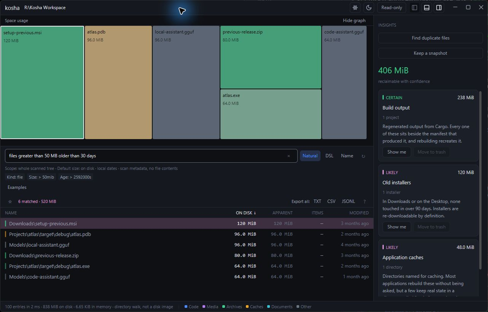
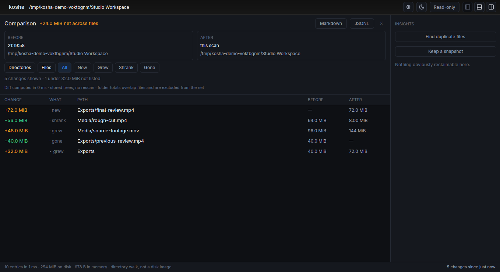
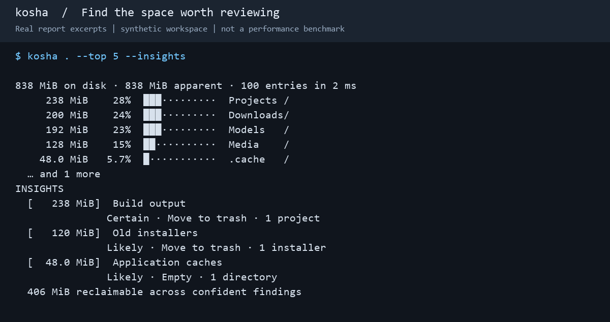
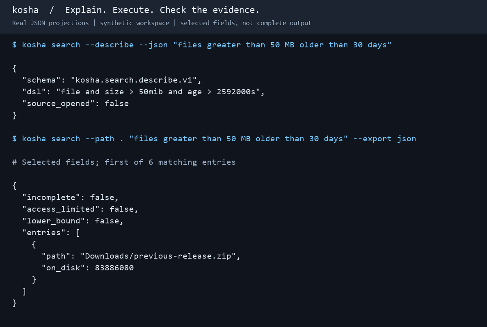

# kosha

**Disk space, explained. For you and your coding agent.**

Find the space hogs, ask **“files greater than 50 MB older than 30 days”**, and
see exactly what the query means. Kosha brings a **native visual explorer**, a
**scriptable CLI**, **scan comparisons**, and a **search recipe marketplace**
into one disk investigation workflow.

**[Download / releases](https://github.com/coolnew/kosha/releases)** ·
[Build from source](#build-from-source) · [User manual](docs/manual/README.md) ·
[Agent quickstart](LLMS.md)

Windows · Linux · Experimental macOS · Written in Rust · MIT OR Apache-2.0

*One question, six matches. The map, file list, interpretation, and findings
stay together. This synthetic workspace includes models, media, downloads,
and build output; the app is read-only.*

## Find it. Understand it. Decide what to do.

**“What’s filling my disk?”** Follow the largest rectangles, sort the table,
and press **Space** to inspect an entry. Distinguish allocated space from
logical size, see file types, and drill into the folders that matter.

**“Which files match what I’m looking for?”** Search the loaded scan by size,
type, path, ownership, and recorded dates. Use supported natural phrases,
inspect or edit the DSL, or choose literal name search. Translation runs
locally without an ML model or cloud service; desktop search reuses the scan.

**“What can I reclaim?”** Review findings for build output, caches, old
installers, and wasted allocation—with explanations and confidence levels.
Request content-hash checks to confirm duplicates. The desktop starts
read-only; cleanup requires an explicit mode change and a reviewed plan.

**“What changed since last time?”** Keep named snapshots and compare scans,
then export the comparison as Markdown or JSONL. Completed drive scans also
keep an automatic historical record. Reopen it with its age visible, or scan
again; an interrupted scan preserves the previous completed record.

*Snapshot comparison on Linux. See which files changed, the net change across
files, and the Markdown and JSONL export controls.* [Snapshot guide](docs/manual/snapshots.md) ·
[Keyboard shortcuts](docs/manual/keyboard.md)

*The same investigation from a terminal. Real report excerpts from synthetic
files; sizes and timings are illustrative, not a performance benchmark.*

## A visual tool for people. A predictable tool for agents.

| For you | For your scripts and coding agents |
| --- | --- |
| Explore a space map and exact file table together | Export JSON, JSONL, CSV, or full-path TXT |
| Ask a supported question and inspect its interpretation | Use `search --describe --json` before opening a scan source |
| Browse a saved scan and compare observations | Search a snapshot without rescanning its original filesystem |
| Review explanations before choosing cleanup | Read explicit coverage flags and diagnostics; the CLI has no delete command |
| Add phrases that fit your workflow | Share the same deterministic recipe vocabulary across GUI and CLI |

An agent can explain a phrase first, execute it against an explicit source,
and inspect whether the result is incomplete or access-limited. JSON exports
carry integer byte sizes and coverage metadata. Data goes to stdout and
diagnostics to stderr, so pipelines can consume results without scraping a UI.

*Real JSON with selected fields and the first matching entry shown. The full
command output is available to the caller; this image is a compact projection.*

Try the commands yourself:

    kosha . --top 25 --insights
    kosha search --describe --json "files greater than 50 MB older than 30 days"
    kosha search --path . "documents" --export json --absolute-paths
    kosha search --load saved.kosha "files greater than 50 MB" --export csv

CLI path scans are fresh and full-depth by default. `--cache` explicitly opts
into a historical drive record; `--load` selects a saved snapshot. Exports
include every match, even when the displayed rows are limited. Desktop search
exports support TXT, CSV, and JSONL.

[CLI reference](docs/manual/command-line.md) · [Query language](docs/manual/query-language.md) ·
[LLMS.md](LLMS.md) / [llms.txt](llms.txt)

## Give search your vocabulary

Use **marketplace recipe packs** to recognize developer tools, caches,
documents, model files, and other workflows. Inspect a pack, install the
compatible version you choose, and use its phrases offline in both interfaces.
The desktop command palette provides discovery and pack management too.

    kosha marketplace sync
    kosha marketplace search developer
    kosha marketplace show coolnew/windows-essentials
    kosha marketplace get coolnew/windows-essentials

On Linux, choose `coolnew/linux-essentials`. Add your own exact aliases,
typed templates, or regex captures, and inspect the query they produce.
Typo suggestions wait for you to choose a correction. Packs are declarative,
execute no scripts, and are verified against catalog hashes and a pinned revision.
Kosha currently installs recipe packs; executable plugins are not supported.

[Browse the marketplace guide](docs/manual/marketplace.md) ·
[Customize your phrases](docs/manual/search-recipes.md) ·
[Author and test a pack](docs/manual/recipe-authoring.md)

## Coming from another disk tool?

Kosha aims to bring visual space exploration, file metadata queries, saved-scan
comparisons, and automation together. Choose it when you want to carry the
same investigation from a desktop view into a script or agent workflow.

| Your familiar starting point | Why try Kosha for that workflow? |
| --- | --- |
| [WinDirStat](https://windirstat.net/) or [WizTree](https://diskanalyzer.com/about): explore where the space went | Follow the map with inspectable natural-language filters, saved comparisons, and a companion CLI |
| [du](https://www.gnu.org/software/coreutils/manual/html_node/du-invocation.html) or [ncdu](https://dev.yorhel.nl/ncdu): investigate disk use from a terminal | Combine ranked findings, metadata search, snapshots, and structured exports in one command-line tool |
| File filters assembled with `find` or PowerShell | Express a supported question as words or DSL, inspect its meaning, and export the complete result |

These are overlapping workflows, not command-for-command replacements.
Kosha searches explicit scans and saved records; it does not maintain a live,
always-updating filename index like [Everything](https://www.voidtools.com/support/everything/).

## Get started

For published builds, use [Releases](https://github.com/coolnew/kosha/releases).
Archives contain **`kosha` (CLI)**, **`kosha-gui` (desktop)**, licenses, and the
offline [manual](docs/manual/README.md). Source builds are available below.

- **Windows:** extract the archive and launch `kosha-gui.exe`; run `kosha.exe`
  from a terminal for the CLI.
- **Linux:** follow the [installation guide](docs/manual/linux.md) for desktop
  prerequisites and integration.
- **macOS:** use the experimental app bundle and companion CLI; interactive
  validation is more limited.

Pre-release builds and unsigned binaries may trigger operating-system warnings.
Check the supplied SHA-256 files when downloading release archives.

    kosha --version
    kosha --help
    kosha . --stats

Search uses recorded filesystem metadata, not file contents. Unknown creation
dates stay unknown, and historical results carry their original observation.
Read the [desktop tour](docs/manual/desktop-tour.md),
[scan scope](docs/manual/scanning.md), and [safe cleanup guide](docs/manual/safety.md)
for details.

## Build from source

Use Rust 1.90+ for the CLI and Rust 1.92+ for the locked Linux GUI build.
Development checks use Python 3.11+. The first GUI build compiles GPUI
dependencies; Linux prerequisites are in the [build guide](docs/manual/linux.md#build-from-source).

    cargo build --release -p kosha-cli -p kosha-gui
    cargo test --workspace
    cargo clippy --workspace --all-targets -- -D warnings

See [test quality and coverage reports](docs/manual/quality-and-coverage.md),
[coverage runs](https://github.com/coolnew/kosha/actions/workflows/coverage.yml),
[Contributing](CONTRIBUTING.md), [Releasing](RELEASING.md), and
[Changes](CHANGELOG.md). Include `kosha --version`, platform, scan method, and
a reproducible example in bug reports; redact private paths. Report sensitive
vulnerabilities through [the security policy](SECURITY.md).

**Development disclosure:** Kosha was created with assistance from large language
models (LLMs), including code and documentation. The maintainer remains
responsible for review, testing, and release decisions.

Dual licensed under [MIT](LICENSE-MIT) or [Apache 2.0](LICENSE-APACHE).
