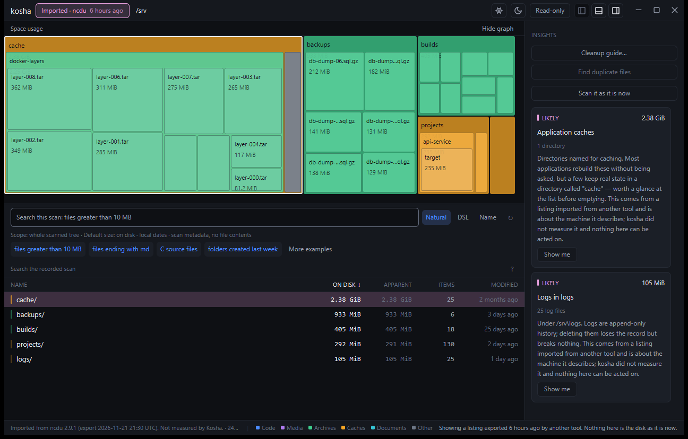
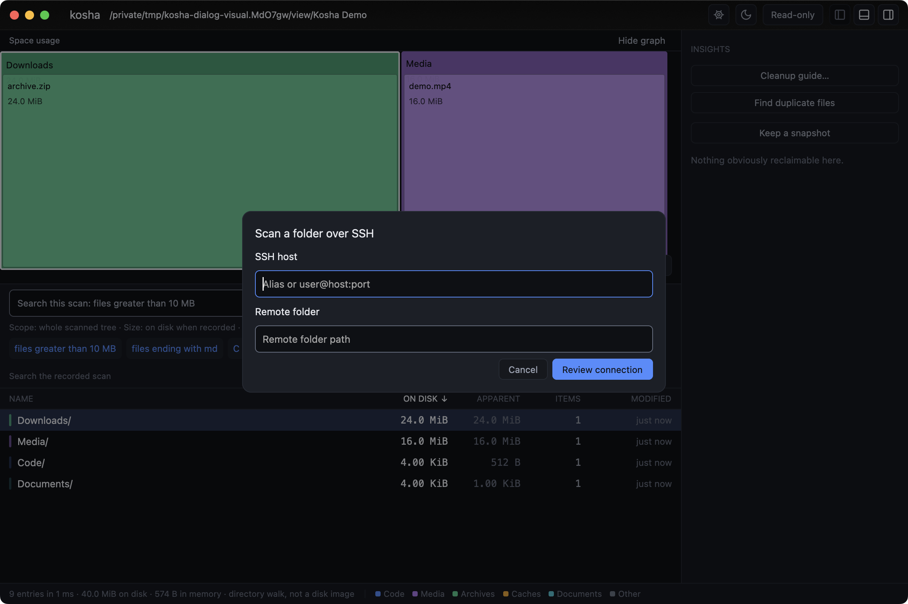
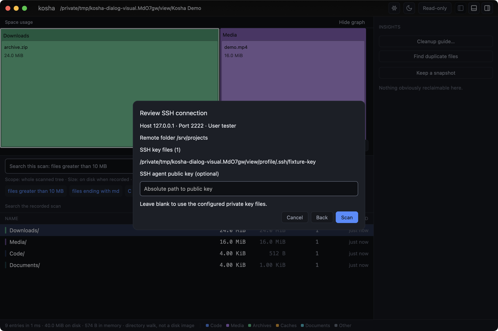
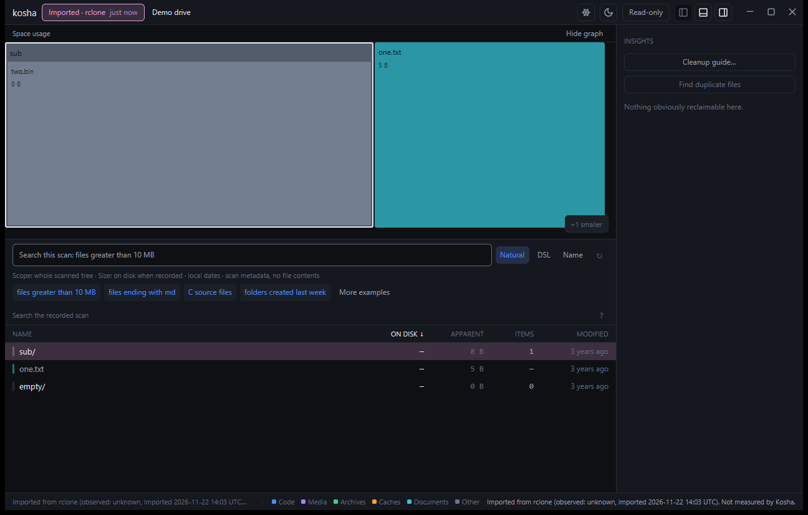
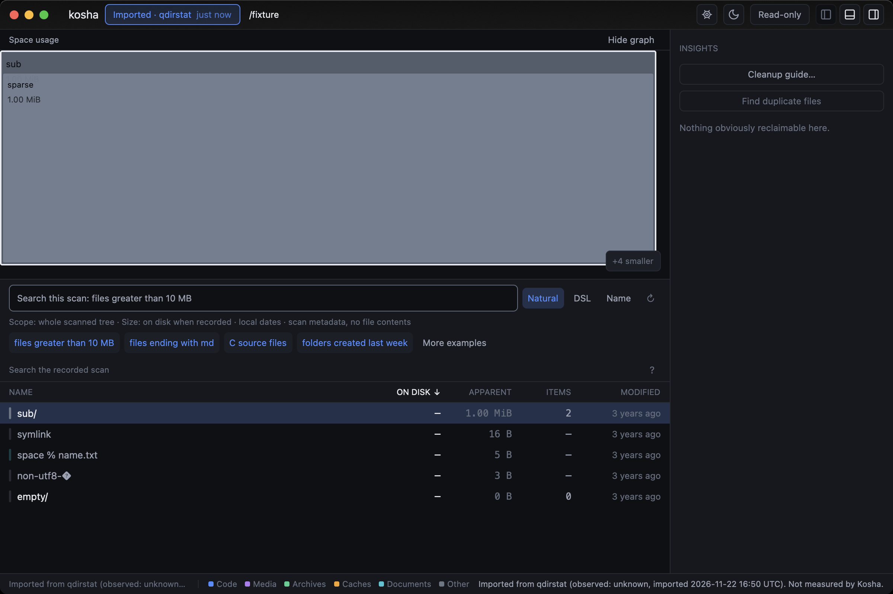
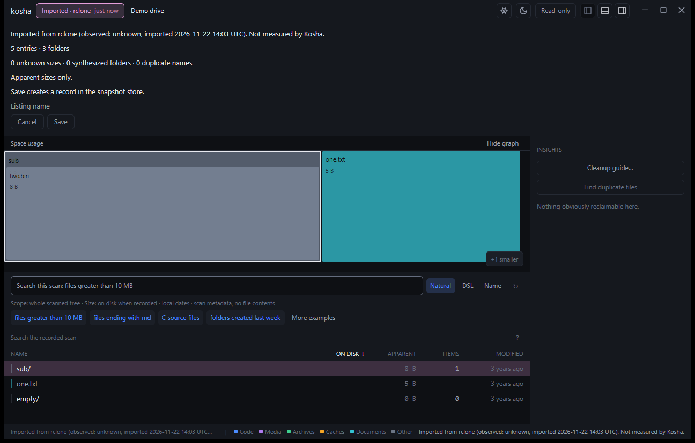

# Cloud storage and other machines

Kosha scans folders this computer can read and opens saved snapshots. To
inspect another machine, transfer its snapshot or [build with SSH
scanning enabled](#ssh-scanning-in-opt-in-builds).

## Cloud storage

Kosha does not scan online accounts and sends nothing over the network for this.
To see what your cloud storage holds on this computer, scan the folder that the
provider's own app keeps in sync:

- Google Drive for desktop
- OneDrive
- Dropbox
- iCloud Drive (macOS)

Kosha reads that folder like any other local folder. It sees only files that
have a local entry. The provider's app may contact its service while the folder
is read; that is the app's behavior, not a request made by Kosha.

Some providers leave a **placeholder** for a file whose data is not stored on
this computer. Kosha recognizes a placeholder only from a marker the operating
system sets on the entry, never from a name:

- A placeholder's full length is shown as its apparent size. This is an upper
  bound, because most of the data is not on this disk.
- Kosha never opens a placeholder, so scanning does not download it.
- Duplicate searches and fragmentation checks skip placeholders and report how
  many they skipped.
- Linux has no standard marker, so no file there is recognized as a placeholder.

[Cloud-synced folders](scanning.md#cloud-synced-folders) lists each marker and
how far it has been tested. Google Drive for desktop has not been verified with
Kosha. If its streamed files carry no marker, Kosha treats them as local, so do
not run a duplicate search on a streamed Drive folder.

### Deleting in a synced folder

Deleting a synced file usually deletes the online copy too. From Kosha 0.12.2,
a Trash or permanent-delete plan that includes placeholders shows a warning with
the count and offers **Skip cloud-only items**. See
[cloud placeholders](safety.md#cloud-placeholders).

The warning has limits. A file that is fully downloaded carries no marker, so
it gets no warning even though deleting it may still delete the online copy.
Versions before 0.12.2 do not warn. Keep Kosha in Read-only mode for synced
folders you do not intend to clean, and use the provider's app to free space.

### Warning: mounted cloud filesystems

Some tools present an online account as a mounted filesystem, for example
`rclone mount`, a FUSE filesystem, or a network drive made with WinFsp.

- Reading a file through such a mount downloads it.
- Kosha cannot flag those files as placeholders, so it treats them as ordinary
  local files.
- Do not run a duplicate search, or any exact or content-reading feature, on a
  mount. Those features read file contents.

By default a scan does not descend into a mounted filesystem below the folder
you scan. On Linux and macOS Kosha compares device IDs, and on Windows it
recognizes volume mount points. It shows the mount point as a boundary and does
not enter it unless you turn on crossing filesystems (`--cross-fs` on the
command line). If you choose a mount itself as the scan folder, Kosha lists its
contents, and the mount software may contact the service to do so. Kosha has
not been tested against a live rclone, FUSE or WinFsp mount on any system, so
treat what happens there as untested.

## Other machines

The standard downloads support scanning on the other machine and opening a
copy of its snapshot here. From Kosha 0.13.0, a
listing made by ncdu on the other machine can be imported instead; see
[without Kosha on the other machine](#without-kosha-on-the-other-machine).

1. Install Kosha on the other machine and scan there, keeping a snapshot:

   ```sh
   kosha /srv --snapshot --label "build-box /srv"
   ```

   The report ends with a `kept at` line, and `kosha --snapshots` lists saved
   snapshots with their paths. Kosha writes the snapshot to its own data
   directory; the command has no option to choose another location.
2. Copy the `.kosha` file to this computer with any tool you already use, such
   as `scp`, a shared folder or a USB drive. Snapshots are in the `snapshots`
   folder of the data directory:

   | System | Snapshot folder |
   | --- | --- |
   | Windows | `%LOCALAPPDATA%\coolnew\kosha\snapshots` |
   | Linux | `$XDG_DATA_HOME/kosha/snapshots`, or `~/.local/share/kosha/snapshots` |
   | macOS | `~/Library/Application Support/app.coolnew.kosha/snapshots` |

3. Open it on this computer:

   ```sh
   kosha ./build-box.kosha --stats
   kosha search --load ./build-box.kosha "files over 1 GB"
   kosha-gui ./build-box.kosha
   ```

   Use `./` or a full path so Kosha opens the file you copied. To see how a
   tree changed, compare two snapshots with `--since`; see
   [snapshots](snapshots.md).

A snapshot is a historical record of the other machine's tree at the time it
was taken. Opening it does not touch that machine, and it is not the disk as it
is now. File actions are not available on it, and it holds no file contents,
so scan again before changing files. An older Kosha
refuses a snapshot written by a newer one, so keep versions aligned.

A snapshot can be opened on a different operating system from the one that
recorded it. From 0.12.2, opening a Linux snapshot on Windows replaces file
names that Windows cannot represent with the replacement character and reports
how many; see [snapshots from another system](snapshots.md#snapshots-from-another-system).

### Without Kosha on the other machine

From Kosha 0.13.0, run [ncdu](https://dev.yorhel.nl/ncdu) there and import its
JSON export here:

```sh
ssh build-box ncdu -co- /srv | kosha import --from ncdu - --label "build-box /srv"
kosha --snapshots
```

You open the SSH session and run ncdu; Kosha only reads what arrives on its
standard input (or a file you name), starts no program and makes no network
request. The record says everywhere that it was imported and not measured by
Kosha. See [imported listings](snapshots.md#imported-listings).



### SSH scanning in opt-in builds

SSH scanning is available when you build Kosha from source with the SSH
Cargo features. Standard downloads use the default build configuration.
To build both clients and the server command from the repository root:

```sh
cargo build --release --locked -p kosha-cli -p kosha-gui --features kosha-cli/remote-client,kosha-cli/remote-serve,kosha-gui/remote-client
```

For a scan host that only serves scans, build `kosha-cli` with
`--features remote-serve`. Put that host's `kosha` binary on the PATH used
by noninteractive SSH sessions. Use an SSH account that can read the folder.
Kosha opens one SSH session and runs the fixed command `kosha serve-scan`.

On the client, enable **SSH access** in Settings. A CLI-only installation
can set `"ssh-access": true` in [settings.json](settings-and-files.md).
SSH access defaults to off. Verify the host fingerprint through a trusted
channel and add the key to a supported known-hosts file. Missing, changed
and revoked keys stop the connection.

In the desktop command palette, choose **Scan a folder over SSH**. Enter
the host alias or `user@host:port` and the absolute folder path on the
scan host, then choose **Review connection**.



Check the resolved host, port, user and remote folder before choosing
**Scan**. In the dialog, Tab moves between fields, Enter runs the primary
action, and Escape closes the dialog or cancels a scan in progress.



In a terminal:

```sh
kosha remote build-box --path /srv/projects
```

Kosha normally tries configured private key files. To use a key already
loaded into your agent, provide its public key file in the desktop
connection review or pass `--agent-key /absolute/path/to/key.pub`.
On Unix, the agent must be accessible through `SSH_AUTH_SOCK`. On Windows,
Kosha uses the Windows OpenSSH agent service. A Unix terminal can prompt
for an encrypted key's passphrase with echo disabled. For an encrypted key
in the desktop app, unlock it in your agent and select the public key.

The SSH configuration supports direct connections and a subset of
`~/.ssh/config`, including `Host`, `HostName`, `User`, `Port`,
`IdentityFile`, `IdentitiesOnly`, `UserKnownHostsFile`,
`StrictHostKeyChecking yes` and bounded `Include` entries inside `.ssh`.
Explicit users and ports override the config. Jump hosts, proxy commands
and host certificates are unavailable. Accepted login keys include
Ed25519, ECDSA and RSA with SHA-2 signatures. The default user trust files
are `known_hosts` and `known_hosts2` in `.ssh`. Kosha also checks the
platform's system trust files and `ssh_known_hosts` in its settings
directory. A non-default port uses a `[hostname]:port` known-hosts entry.

The desktop shows a read-only SSH snapshot for browsing and search.
File opening, cleanup and rescan actions against the recorded paths are
unavailable. Start another SSH scan to refresh the result.

## What is not available yet

- Scanning online accounts directly.
- Importing QDirStat listings.

## Tell us what is missing

If your files live somewhere Kosha cannot reach today, tell us with the
[scanning sources issue form](https://github.com/coolnew/kosha/issues/new?template=scanning_sources.yml).
Say which provider or tool you use, your operating system, the rough size of the
tree and what you tried. The request is public, so leave out private paths,
account names and file names.

## Import an rclone listing



For Google Drive, configure an rclone remote such as `gdrive:`. For OneDrive
or Dropbox, use the remote name you configured for that provider. Run rclone
to produce a listing, then give the JSON file to Kosha.

```sh
rclone lsjson -R gdrive: > drive.json
kosha import --from rclone drive.json --root gdrive:
```

Kosha browses the imported metadata locally. The listing shows apparent sizes.
An rclone size of `-1` means unknown. These entries contribute zero, so totals
can be lower bounds.
Duplicate names are retained. File actions are unavailable in imported listings.

Use `--from auto` to detect ncdu, rclone or QDirStat input. Use `--out FILE` to save
the snapshot at a chosen path. An existing destination is preserved.

## Import a QDirStat cache



Use `qdirstat-cache-writer /srv srv.cache.gz` on the source machine, then
run `kosha import --from qdirstat srv.cache.gz` where you want to browse it.
The importer accepts plain and gzip caches in formats 1.0 and 2.0. Sizes
are apparent and each hard-link name contributes its recorded size.

### Preview a listing in the desktop app



In the desktop app, choose **Import a listing…** under **Snapshots**, select
an ncdu, rclone or QDirStat listing, and review the summary. You can name the record,
then select **Save** to open it and retain it in the snapshot store. **Cancel**
dismisses the import before a record is saved.

JSON and JSONL exports represent unrecorded on-disk sizes as null. CSV
leaves the on-disk column empty for these listings.
