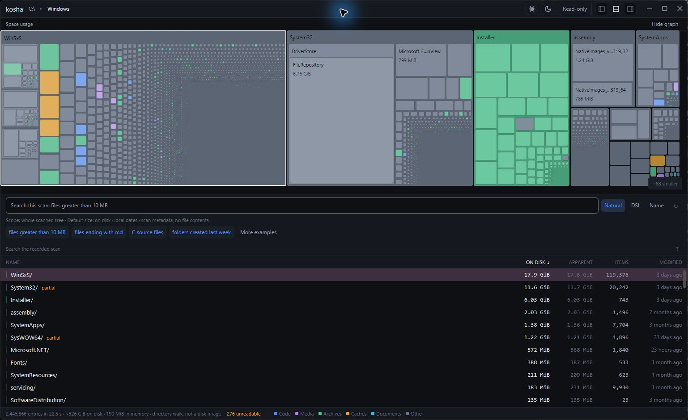
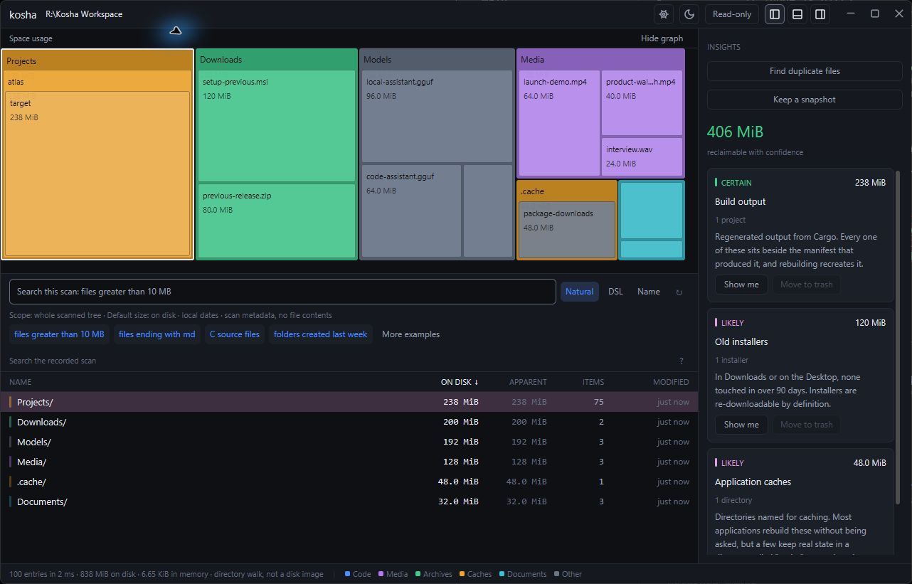
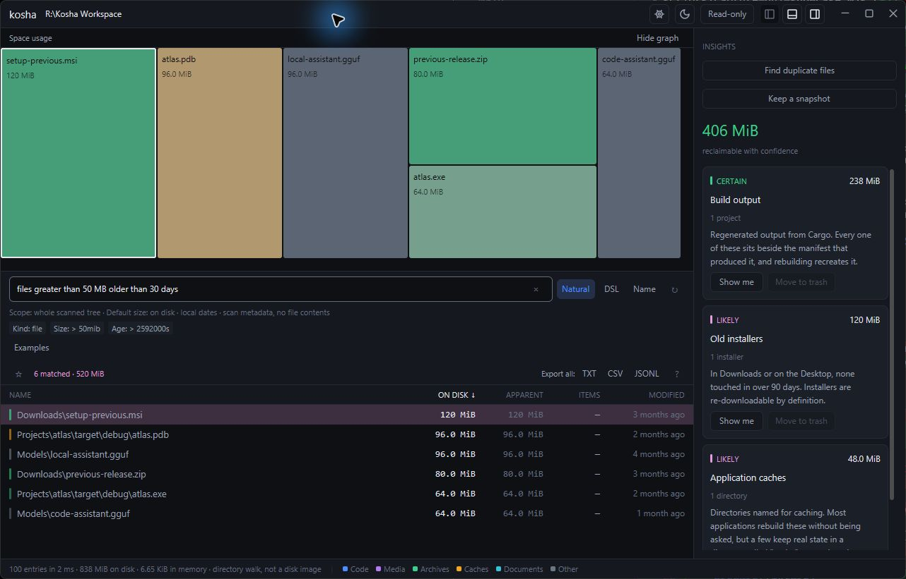
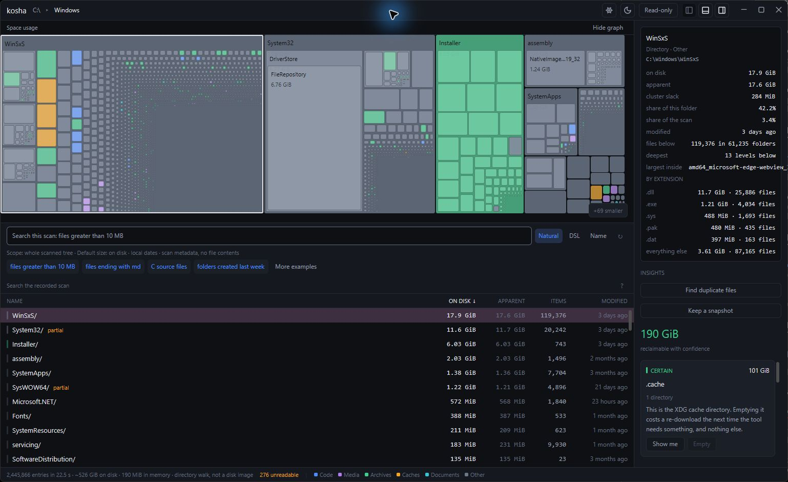
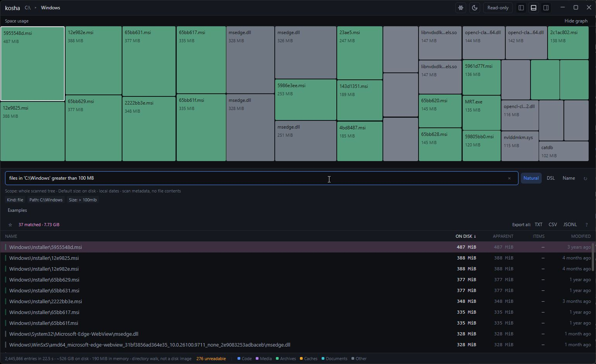

# Illustrated desktop tour

Use **Ctrl+K** on Linux or Windows to find a feature by name. The palette
changes with the current view, so scan a folder first to see commands that
operate on a scan.

| What you want to do | Where to look |
| --- | --- |
| Scan a folder, mounted volume, or disk image and understand partial results | [Scan scope and progress](scanning.md) |
| Sort and resize columns, inspect an entry, search or export every match | [Results, search, and findings](results-and-search.md) |
| Define a custom phrase or inspect how it translates | [Search recipes](search-recipes.md) |
| Confirm duplicates or see usage by account | [Duplicates and ownership](results-and-search.md#findings-duplicates-and-ownership) |
| Keep a previous drive observation or compare it with another scan | [Snapshots and comparisons](snapshots.md) |
| Review a cleanup plan, change mode, or find the audit log | [Cleaning up safely](safety.md) |
| Pin folders, adjust appearance, or find settings and saved files | [Settings and stored files](settings-and-files.md) |
| Use the window controls and keyboard | [Keyboard and window controls](keyboard.md) |

The desktop executable is **kosha-gui** (`kosha-gui.exe` on Windows). It opens
with a dark theme by default; display preferences are remembered. The separate
`kosha` command is the [terminal scanner](command-line.md).

The Windows system-folder screenshots show the real app after a C: directory scan,
browsing `C:\Windows`. Personal folders and sidebar details are hidden. The
images contain system-file metadata rather than personal filenames. Sizes,
dates, and counts belong to this example machine and will differ on yours.
The additional workspace example below uses synthetic files and an isolated profile.
The examples inspect files in read-only mode; see [safe cleanup](safety.md)
before taking file-changing actions.

## Read the space-usage map

Select a drive or folder on the left to scan. A drive with an automatic saved
record can open immediately: its **Saved scan** label shows the age and
**Scan again** requests a fresh scan. During scanning, the entry count and
estimate update; **Escape** or **Stop scan** cancels. An unfinished scan is
marked incomplete and does not replace the last completed drive record.

The largest rectangles identify the largest allocations. Open a directory in
the map or table to inspect its children. Use the breadcrumb or **Backspace**
to move back. The breadcrumb names the folder being browsed; the status bar
continues to describe the original scan and its coverage. Permission-limited
folders are marked **partial**, separately from an incomplete/stopped scan.

The table distinguishes **On disk** allocation from **Apparent** logical size.
Click column headings to sort and drag their edges to resize. Colors correspond
to the category legend; they do not indicate that a file is safe to remove.
The title-bar panel controls show/hide places, the table, and the right panel.

## A workspace with recognizable findings

This additional example uses synthetic files in `R:\Kosha Workspace` and an
isolated app profile. Cargo output beside its manifest, an older installer in
Downloads, and a cache directory produce different findings and confidence
levels. They are review opportunities, not permission to delete similarly
named files on your machine. Sizes and RAM-disk timings are illustrative.

The same workspace can answer **files greater than 50 MB older than 30 days**:

The six results include models, build files, and downloads. A matching file is
not necessarily disposable; use the explanation and your knowledge of its
purpose. The graph follows the displayed search matches while the findings
panel continues to describe the whole scan.

## Inspect one entry with quick look

Select a row and press **Space**. Quick look reports the full path, allocated
and apparent sizes, cluster slack, share of the folder and scan, child counts,
and recorded file-type breakdown. Press **Space** again to close it.

The findings panel explains potential cleanup opportunities separately from
the current selection. Findings can describe the overall scan even while you
browse one subfolder. Review their explanations and scope before acting.
Read-only mode leaves file-changing controls unavailable.

## Search the loaded scan

Use **Ctrl+F** to focus search (Command on macOS). Choose:

- **Natural** for supported phrases such as `files greater than 10 MB`,
  `folders created last week`, or the illustrated
  `files in 'C:\Windows' greater than 100 MB`.
- **DSL** to inspect or edit the exact expression interpreted from your words.
- **Name** for a literal filename substring.

The conditions below the input show how the phrase was interpreted. Unsupported
or incomplete text reports a diagnostic instead of silently broadening the
query. **Examples** opens grouped recipes; **?** opens searchable query help.
You can also [define your own phrase recipes](search-recipes.md).

Search covers the **whole recorded scan**, not only the folder open in the
breadcrumb. Include a path condition when you want to restrict it, as in the
Windows-only example. Search does not read file contents or scan again.
Unknown creation timestamps remain unknown; older saved scans can need a fresh
scan before creation-date searches have useful coverage.

**Hide graph**, beside the map, gives results the full vertical column.
**Show graph** restores it and preserves the query. Clear search with its
input clear button. The result count includes all matches while the table
retains up to 2,000 rows; the search map reflects those displayed rows.

## Export, keep, and compare

Use **Export all: TXT / CSV / JSONL** beside the result count and choose a
destination. Every matching recorded entry is included, even beyond the table
limit. TXT contains full paths; CSV/JSONL include full paths and metadata.
Export captures the query you selected and does not rescan the filesystem.

Use **Keep a snapshot** to retain an explicit observation. A saved drive scan
can also be kept with its original scan date. Explicit snapshots appear in the
sidebar; **All**/**This location** narrows their scope. **What changed** compares
recorded data, and comparison reports can be exported. See
[snapshots and comparisons](snapshots.md) for coverage and scope rules.

## Find controls and preferences

**Ctrl+K** opens the command palette; search by an action or location name.
The gear opens Settings, whose search filters names, explanations, aliases,
saved searches, and pinned folders. Scrollbars keep longer panels and dialogs
usable in shorter windows. Scan-option changes affect the next scan.

Windows supports title-bar double-click to maximize/restore and the native
maximize/Snap control. See [keyboard and window controls](keyboard.md) and
[settings and stored files](settings-and-files.md).
