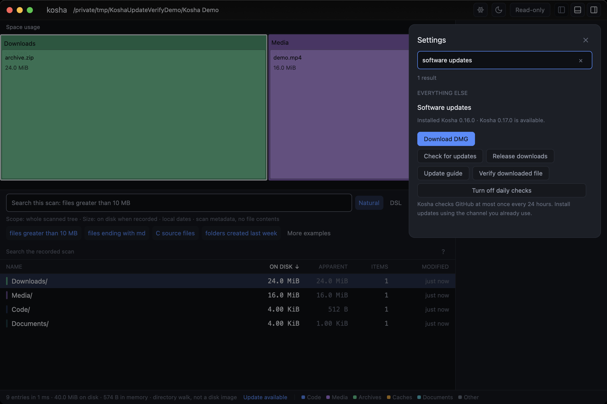

# Choose a download

Download Kosha from the [official releases](https://github.com/coolnew/kosha/releases).
Choose a regular release for ordinary use, or a numbered pre-release to test
candidate changes. Read the selected release's notes: older versions do not
gain new packaging features automatically. This page describes the current
source's packaging, including changes awaiting the next release.

| Download | Contents and use |
| --- | --- |
| Windows `*-x64-setup.exe` | Offline NSIS installer for the GUI, CLI and manuals. Offers per-user or all-users installation, a Start menu shortcut, optional CLI PATH integration, upgrades and uninstall. |
| Windows `*-x86_64-pc-windows-msvc.zip` | Portable GUI, CLI and manuals. Extract before running; no installation, automatic PATH change, shortcut or uninstaller. |
| Windows `*-x64-store-upload.msix` | Unsigned package for submission to Microsoft Partner Center. It is **not** a consumer sideload installer. A Store-installed copy gets its signature through Microsoft. |
| macOS `*-aarch64-apple-darwin.dmg` | Apple Silicon app bundle, companion CLI, manuals and Applications shortcut. See [macOS installation](macos.md) for signing limitations and first-launch steps. |
| Linux `*-x86_64-unknown-linux-gnu.tar.gz` | GUI, CLI, desktop integration files and manuals. See [Linux prerequisites](linux.md). |
| `*-source.zip` / `*-source.tar.gz` | Reviewed public source and build instructions, without compiled Kosha executables. |
| `*.sha256` and `release-manifest-*.json` | Checksums and build provenance. These are verification files, not installers. |

New Windows packages use the same **static Visual C++ runtime** CLI and GUI
binaries across ZIP, Setup and MSIX. They do not require a separately installed
`VCRUNTIME140.dll` or Visual C++ Redistributable. Windows system libraries and
supported graphics drivers are still required. Earlier releases, including
0.10.6 and 0.10.7-rc.2, were built differently; this promise does not apply to them.
The packaging gate checks ordinary and delay-load PE imports before distribution.

## Update an existing installation

If you are using Kosha 0.17.1, update once using the package from
[GitHub Releases](https://github.com/coolnew/kosha/releases).
Version 0.17.2 adds support for the attestation download format used by
GitHub's public API.

In the desktop app, search Settings for **Software updates**. Select **Check
for updates** to compare your version with GitHub's latest stable release.
**Release downloads** opens the matching release in your browser. Enable
**Turn on daily checks** if you want Kosha to look for updates at launch.
For a newer release, the package buttons open the official asset directly in
the browser. Windows Setup and portable copies use this GitHub route.
Store and managed MSIX copies use the package-provider route described below.

Choose **Verify downloaded file** in Settings or run `kosha update verify FILE`
on a package saved by the browser. Keep its
original filename so Kosha can match it to the latest stable release. On
Linux, `kosha update download --to DIR` downloads the archive into an
existing directory, checks its size and SHA-256, and preserves any existing
file. It can also save the current stable archive for a reinstall. The size
and digest come from GitHub release metadata. Follow the
platform's installation and publisher checks when opening the package.



Software updates on macOS, shown with a sample newer release. GitHub Windows
copies show Setup and portable ZIP download buttons in the same panel.

In a terminal, run `kosha update check` for the version and links, or `kosha
update open` to open the release or update guide. `kosha update download`
opens the newer package directly on macOS, Linux, or a recognized Windows
Setup installation. On other unpackaged Windows copies, specify
`kosha update download setup` or `kosha update download zip`.
`kosha update automatic on`
enables launch checks for the desktop and ordinary interactive CLI scans.
`kosha update automatic off` turns them off. Set `KOSHA_NO_UPDATE_CHECK` to
disable GitHub checks for the process. Both front ends share one check per
24 hours per data profile.

Choose the route that matches your existing installation.

| Installed from | How to update |
| --- | --- |
| Microsoft Store | In Settings → **Software updates**, choose **Open Microsoft Store updates**. Microsoft Store checks for and installs Store updates. |
| Separately signed and managed MSIX | Use the organization’s deployment tool or the App Installer source that installed the package. |
| Windows Setup | On a recognized Setup installation, choose **Download and open Setup** or run `kosha update install`. You can also run the newer installer from Releases using the same installation scope. |
| Windows portable ZIP | Extract the newer ZIP to a fresh folder and start Kosha there. Keep the old folder until the new copy works. Adjust any PATH entry that points to the old copy. |
| macOS DMG | Choose **Download and open DMG** or run `kosha update install` to open a newer attested image. Quit Kosha and replace the app in Applications. Update a separately copied CLI using [the macOS installation steps](macos.md). |
| Linux archive or WSL | Use the managed Linux update below when available, or extract the newer archive and redirect any existing launchers. In WSL, run the update inside the distribution. |
| A package manager | Update Kosha using the package manager that installed it. |

Close applications using a package before replacing it. Use the supplied
checksums to verify downloads and follow the platform's usual installation
prompts. For manually managed copies, `kosha --version` confirms which CLI
your terminal is running after an update.

On Apple Silicon, Kosha verifies the downloaded image against its GitHub
release attestation before opening it in macOS. Use Finder to replace
`Kosha.app`. Follow [macOS first-launch instructions](macos.md) if macOS
asks for approval. The GitHub image can also be downloaded and opened manually.

## Managed Linux updates

On supported Linux builds, select **Download and install update** in
Settings → **Software updates**, or run `kosha update install`
in a terminal. Kosha downloads the newer stable release from GitHub and
checks its signed release attestation before installing it for your account.
Only releases with a valid attestation offer this install path.

The first install creates `~/.local/bin/kosha` and
`~/.local/bin/kosha-gui` if those names are free. If a different file or
symlink already uses either name, Kosha stops and reports the conflicting
path. Later updates switch both launchers together and keep the previous
version files. Quit the desktop app and launch
`~/.local/bin/kosha-gui` to use the new version. If your terminal still
finds an older copy, run `~/.local/bin/kosha --version` to verify the
managed copy directly.

To return to the previous managed release, run `kosha update rollback`.
To reactivate a specific retained release, run `kosha update rollback VERSION`
using its version number, for example `0.16.0`. Both launchers switch
together without a download. Restart the desktop app to use that version.

## Windows Setup

Setup defaults to **just you**, under `%LOCALAPPDATA%\Programs\Kosha`.
Choose **Install for all users** for installation under Program Files; Windows
asks for administrator approval. The GUI runs normally afterward. Installing
for all users does not automatically elevate scans or enable MFT access.

The PATH checkbox adds the installation directory to your user PATH or the
machine PATH for the chosen scope. Open a **new terminal** afterward and run
`kosha --version`. Existing terminal processes keep their old environment.
PATH updates use native registry buffers to preserve long existing values;
unsupported values or access failures are reported instead of truncating PATH.

Close Kosha before upgrading. Run the newer Setup in the same installation
scope. Downgrades are refused. Uninstall from Windows Settings → Apps; snapshots,
saved scans and settings remain in their [per-user storage](settings-and-files.md).
The uninstaller removes only its own PATH entry if Setup added it, and deletes
known application files without recursively deleting unknown files.
Unchecking PATH on a later upgrade leaves an existing installer-owned entry in
place until uninstall. Avoid installing multiple channels/scopes together:
Windows PATH and Store aliases can select a different `kosha` than intended.
Use `where.exe kosha` to inspect command resolution.

When a newer attested release is available, Settings → **Software updates** →
**Download and open Setup** and `kosha update install` can download and
verify it for an existing Setup copy. Kosha opens the interactive installer
for the existing installation scope and folder. Close any running Kosha
windows or terminal scans before continuing. If Setup asks you to retry,
close them and choose **Retry**. Windows may request administrator
approval for an all-users install and may display its normal download
security prompts.

For unattended installation, `/S` is case-sensitive:

```powershell
.\kosha-vVERSION-x64-setup.exe /S /AddToPath=1
.\kosha-vVERSION-x64-setup.exe /ALLUSERS /AddToPath=1
```

All-users automation should launch Setup from an elevated deployment process.
Otherwise the installer requests UAC consent and relaunches interactively;
that consent flow is not a substitute for managed deployment exit-code reporting.
Setup works offline; Kosha downloads an update only when you request it. Setup EXEs and ZIP
binaries remain unsigned until separately configured code signing is available;
follow your software policy when Windows displays a publisher warning.

## Microsoft Store and managed MSIX

For a copy installed from Microsoft Store, **Open Microsoft Store updates**
opens the Store’s **Updates and downloads** page. Use that page to check
for and install updates. Microsoft Store can also install app updates
according to your Store settings.
[Microsoft Store updates page](https://learn.microsoft.com/en-us/windows/apps/develop/launch/launch-store-app)

Windows identifies both Store installs and separately deployed MSIX packages
as packaged apps. Kosha uses that identity to leave updates to the package
provider. If your organization deployed Kosha, use its deployment tool or
the original App Installer source.
[Microsoft’s MSIX distribution guide](https://learn.microsoft.com/en-us/windows/apps/package-and-deploy/choose-distribution-path)

The GitHub file ending in `-x64-store-upload.msix` is the unsigned submission
that the maintainer uploads to Microsoft Partner Center. Microsoft signs the
package for Store distribution after certification. For a direct GitHub
installation, download **Setup** or the **portable ZIP**.
[Microsoft’s package signing guide](https://learn.microsoft.com/en-us/windows/msix/package/sign-msix-package-guide)

## Windows portable ZIP

Close Kosha, download the newer portable ZIP, and extract it to a fresh
folder. Open `kosha-gui.exe` or run `.\kosha.exe --version` from that folder.
Update any shortcut or PATH entry that points to the previous folder. Keep
the previous folder until you have verified the new copy.

## Portable and Store command-line access

For ZIP use, run `.\kosha.exe` from its extracted directory or add that directory
to your user PATH yourself. Store MSIX uses the Windows **app execution alias**
`kosha.exe`, managed in Settings → Apps → App execution aliases, rather than
putting its versioned WindowsApps package directory on PATH.

The installer is an EXE today. A standalone MSI is not currently distributed;
enterprise MSI packaging would be a separate future addition.
