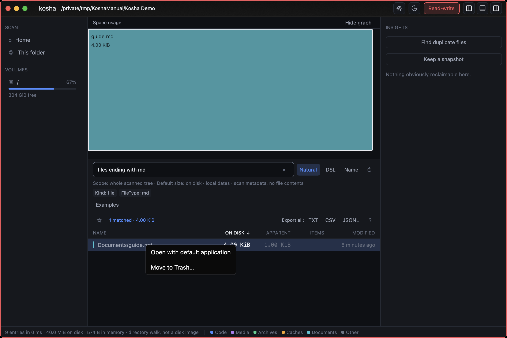
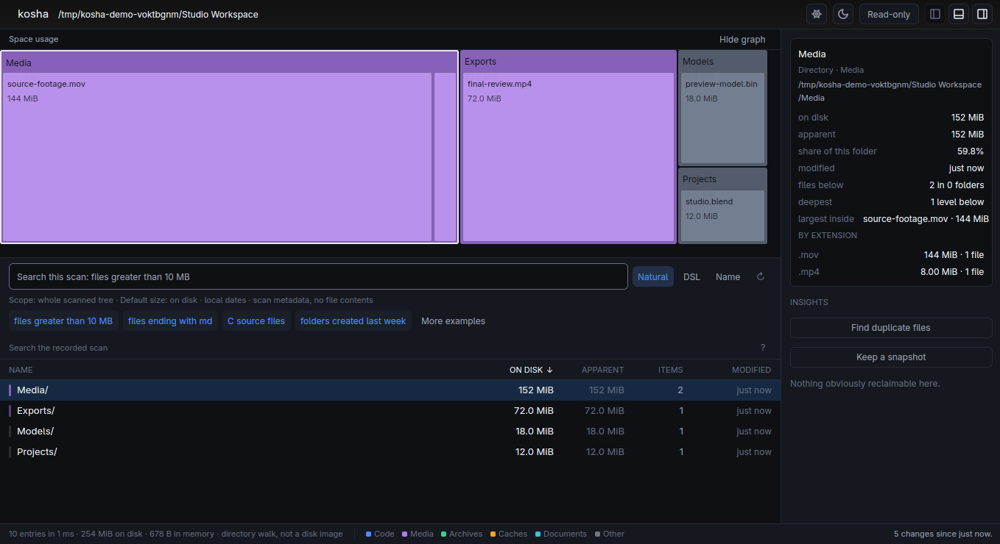

# Keyboard and window controls

The shortcuts below use **Ctrl** on Windows and Linux. On macOS, substitute
**Command (⌘)** for **Ctrl**. The other keys stay the same.

## App shortcuts

| Key | Action |
| --- | --- |
| Ctrl+K | Open or close the command palette |
| Ctrl+O | Choose a folder |
| Ctrl+F | Open search |
| Ctrl+R | Start a fresh scan of the current root |
| Ctrl+Plus or Ctrl+Equals | Increase desktop text size |
| Ctrl+Minus | Decrease desktop text size |
| Ctrl+0 | Restore the system default text size |
| Ctrl+scroll | Increase or decrease desktop text size |
| Ctrl+/ or Ctrl+? | Open query help |
| Ctrl+Shift+M | Request a change between Read-only and Read-write |

On macOS, **Command+Q** quits Kosha. The macOS menu bar also provides
**Kosha → Quit Kosha**, including when a search field or modal has focus.
These controls are part of development after 0.10.6; older builds can use
**Command+K**, type `Quit kosha`, and run that command instead.

## File list and search results

These keys apply when focus is outside a text field.

Double-click a regular file in the list, search results or treemap to open it
with the operating system's associated application. Single clicks select files;
folder navigation is unchanged. A snapshot or disk-image view contains metadata
only: rescan the live folder before opening files. Missing files produce a
notice; links are not launched. Choose trusted files, since their associated
application controls what happens after opening.

The file-opening and entry context actions are additions after 0.10.7.
You can also choose **Open with default application** from an entry's
right-click menu; opening a file does not require Read-write mode.
The same context actions are available on treemap rectangles. Pausing over a
folder rectangle previews its largest recorded children without entering it.

| Key | Action |
| --- | --- |
| Up / Down | Move the selection by one row |
| Page Up / Page Down | Move the selection by up to 12 rows |
| Home / End | Select the first or last row |
| Ctrl+Delete (Windows/Linux), Command+Delete (macOS) | Preview moving the selected live entry to Trash; requires Read-write and confirmation |
| Enter / Right | Open the selected directory in folder view, or reveal the selected match in its containing folder in search results |
| Backspace / Left | Move to the parent directory |
| Space | Open or close Quick Look for the selected entry. Moving the selection updates Quick Look while it is open |
| Escape | Dismiss the foremost Kosha panel or cancel a pending confirmation. Escape can also stop a scan or duplicate hunt and clear a notice |

## Command palette and search field

| Where | Key | Action |
| --- | --- | --- |
| Command palette | Up / Down | Highlight the previous or next matching command |
| Command palette | Page Up / Page Down | Move the highlight by up to eight commands |
| Command palette | Enter | Run the highlighted command |
| Command palette | Escape or Ctrl+K | Close the palette |
| Search field | Tab when a suggestion is visible | Apply the first suggestion |
| Search field | Enter | Return focus to the results so the navigation keys work |
| Search | Escape | Close search once any panel in front of it has been dismissed |

Type in the palette to filter its command list. The available commands and
their displayed shortcuts depend on the current view. In the search field,
arrows, Home, End, and Backspace edit text. During a scan, Escape can stop it
even if an input field has focus.

## Window and panel controls

On Windows, caption controls minimize, maximize/restore, and close the window.
Minimize and close use the app's tooltip style. Maximize/restore keeps native
Windows behavior, including the Snap Layouts chooser on hover where available.
Drag unused title-bar space to
move the window, or double-click it to maximize/restore. Closing the app does
not turn a running scan into a finished saved record.

On Linux, window movement, tiling, and maximize shortcuts depend on the
desktop or window manager. The keys in the table control kosha itself.

Panel controls hide or show the sidebar, table, and findings. At narrow widths,
side panels can be hidden automatically; widen the window to restore space.
The theme control switches between light and dark.
