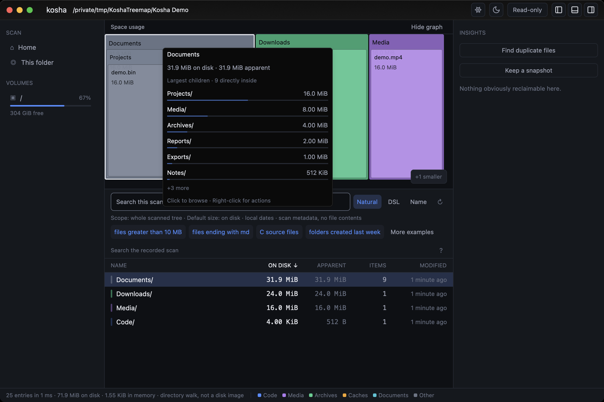
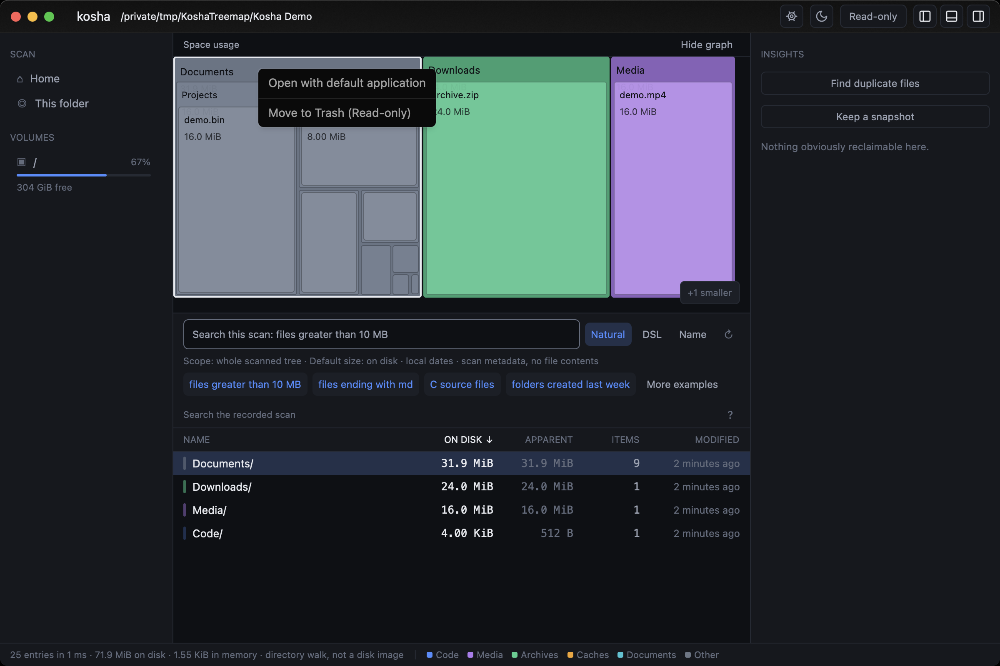

# Results, search, and findings

The [desktop tour](desktop-tour.md) illustrates the map, quick look, and a
privacy-safe Windows-folder search using the real dark-theme app.

You can define [your own phrase-to-DSL recipes](search-recipes.md), shared by
the GUI and CLI. Built-in examples remain available without a recipe file.

## Export search matches

After a search finishes, use **Export all: TXT / CSV / JSONL** beside its result
count. Choose a destination in the save dialog. Every match is included, even
when the table displays only the first 2,000. Export uses the recorded scan and
the query you selected when opening the dialog, without rescanning.

TXT contains one full path per line. CSV and JSONL include full paths and entry
metadata; JSONL writes one object per line. TXT refuses names containing line
breaks; use CSV or JSONL instead. Empty results produce an empty TXT/JSONL file
or a CSV header. The completion notice reports the written count and any lossy
path conversions. Exported metadata can reveal private filenames and paths.

## Map and table

Larger treemap rectangles represent larger disk allocations. Colors group file
categories named by the legend. Open a directory to examine its children; use
the breadcrumb or Backspace to move back. The table provides names, sizes,
counts, and modification information. Click headings to sort. Drag a column
edge to resize; the palette offers column visibility, order, and reset actions.

Select an entry and press **Space** for quick look. It describes sizes, share
of the parent, and other available details. Widen the window if a side panel
is hidden by the layout.

## Understand the numbers

### File-list columns

| Column | What it measures |
| --- | --- |
| **Name** | The entry name when browsing, or its path relative to the scan root in search results. A trailing slash marks a directory. A middle ellipsis means the text was shortened to fit. |
| **On disk** | Bytes allocated on the filesystem, or the scan's allocation estimate where exact measurement is unavailable or disabled. A directory includes the allocation measured underneath it. |
| **Apparent** | Logical file length, including unallocated regions of a sparse file. A directory includes the logical sizes measured underneath it. When hardlinks are deduplicated, a later name for the same data contributes zero to both totals. |
| **Items** | File entries anywhere below a directory, including nested folders' contents. The column excludes the folders themselves. A dash means the row is a file or another non-directory entry. A directory can show zero files even if it contains empty folders. |
| **Modified** | Time since the recorded modification timestamp, or **unknown** when unavailable. It refers to the entry itself. A directory's timestamp is distinct from the newest timestamp among its files. Search can also use creation time when the scan recorded it. |

A six-byte file can occupy one 4 KiB filesystem block. A sparse image can
report 64 MiB apparent and 0 B on disk when all of it is unallocated.
Compression, cloud placeholders (see [cloud-synced folders](scanning.md#cloud-synced-folders)),
skipped subtrees, and hardlink accounting can
also make totals and individual rows differ. Adding a folder's total to the
files listed inside it would count those bytes twice.

Apparent size is useful even when you mainly care about disk use: it explains
sparse/compressed files and allocation rounding. To simplify the list, open the
command palette and choose **Hide the apparent column**. You can restore it
with **Show the apparent column**. The preference is saved; the underlying
measurement and exports keep both sizes.

### Quick look

| Field | What it measures |
| --- | --- |
| Name, kind, path, category | The selected entry, its type such as File, Directory or Link, its full path, and its display category. |
| **on disk**, **apparent** | The same quantities as the file-list columns. |
| **saved by the filesystem**, **cluster slack** | The difference between logical and allocated bytes, when it is nonzero. Sparse or compressed data can occupy less than its length. Allocation rounding can occupy more. |
| **share of this folder**, **share of the scan** | Allocated bytes relative to the containing folder or to the whole scan. The scan share is shown separately when it adds context. |
| **owner**, **modified** | The recorded account when collected, and the age of the recorded modification time. |
| **files below** | Descendant files and folders, listed separately. |
| **deepest**, **largest inside** | Levels below the selected directory to its deepest observed entry, and the largest immediate child by allocated size. |
| **By extension**, **everything else** | Allocated bytes and file counts grouped by extension in the directory subtree. Remaining extensions are pooled. **No extension** groups names without one. |
| Fragmentation | When available and relevant, **in** reports how many file extents were observed. **Over** marks a lower bound. |

Quick look also explains links, already-counted hardlinks, skipped mounts,
cloud placeholders, and unreadable entries when a caveat applies.

### Treemap, volume bars, and scan status

In builds after 0.10.7, pause over a treemap rectangle to see its recorded
on-disk/apparent sizes and, for a folder, up to six largest immediate children.
The preview does not open or rescan the folder. **+N more** counts children not
shown in the preview; **No children recorded** does not promise an unreadable
folder is empty. Sizes retain the scan's access/scope limitations.

Right-click a rectangle for the same **Open with default application** and
**Move to Trash…** controls as the file list. A folder action covers that folder,
including its contents, rather than only the matching rows of a search. Trash
still requires a live scan, Read-write mode and confirmation of the named plan.
Opening files uses the current file on disk; snapshots/images require a live scan.

The treemap uses allocated bytes. **+N smaller** counts entries pooled
because their tiles would be too small. Volume bars show space used and
available as reported by the OS. The status bar's **entries** includes files,
directories, and the root. **In memory** measures the retained scan tree, while
the application's total memory also includes temporary work and other views.
On a saved observation, the timestamp and totals describe when it was taken.
Click the **unreadable** count to open a query for entries the scan could not read.

An unreadable or incomplete result is a lower bound. Drive usage can differ
from scanned totals because of overhead, reserved space, access restrictions,
and scan boundaries.

**GiB** uses powers of 1024; **GB** uses powers of 1000. Settings change displayed
units. Search age is based on modification time; an old timestamp alone does
not establish that a file is unwanted.

## Search

Search is directly above the file list after a scan or saved scan opens.
**Ctrl+F** focuses it. Every mode searches the whole scanned tree, including
descendants outside the folder currently being browsed. Search uses the recorded
index; it does not scan again or read file contents.

Use **Hide graph** in the **Space usage** header above the graph to give the
results the full vertical column; the same header keeps **Show graph** available
to bring it back. The choice is remembered across locations and restarts.
Hiding the results table with its title-bar control
always leaves a map visible.

By default, the space-usage treemap stays above the file list during search. Its tiles show
the displayed matching entries, with their recorded on-disk sizes. Search matches
are shown flat because their children may not match. When results exceed 2,000,
the map represents the displayed rows, while the result count covers all matches.

Choose **Natural** for a phrase, **DSL** for an exact expression, or **Name** for
a literal filename substring. Name mode is useful when a filename itself looks
like a search command. Natural language follows a supported deterministic grammar;
it does not use a model, a network service, or file-content classification.

| Natural phrase | Meaning |
| --- | --- |
| `files greater than 10 MB` | Files using more than 10 MiB on disk |
| `files apparent size over 10 MB` | Files whose recorded data length exceeds 10 MiB |
| `files logical size over ten megabytes` | The same data-length filter, using a spoken quantity |
| `files allocated size under 1 MB` | Files using less than 1 MiB on disk |
| `files apparent size over 10 MB and allocated size under 1 MB` | Large data lengths with small recorded allocations |
| `files ending with md` | Files with the Markdown extension |
| `files which are c code` | C source files with the `.c` extension |
| `documents` | Common document extensions |
| `excel sheet` | Spreadsheet extensions |
| `word doc` | Word document extensions |
| `image` | Common image extensions |
| `folders created last week` | Folder birth times in the previous Monday–Sunday calendar week |
| `documents except pdf` | Document extensions with PDF excluded |
| `pdf or xlsx files` | Either extension, restricted to files |
| `files starting with "report"` | Names with that literal prefix |
| `files with names ending with ".tar.gz"` | A complete filename suffix, not just the final extension |
| `empty files` | Zero apparent bytes; zero allocation alone does not mean empty |
| `empty folders` | Directories with no children |
| `files created in last 24 hours` | Exact rolling birth-time interval, excluding future and unknown dates |
| `files larger than ten megabytes` | A spelled quantity, normalized to the same exact size filter |
| `files at least one point five GB` | A decimal spoken quantity |
| `folders with at least one hundred files` | At least 100 files anywhere below each directory |
| `files modified in October 2026` | The complete local calendar month |
| `files created on November 5, 2026` | That complete local calendar day |
| `files created two days ago` | The complete local day two days before today |
| `files modified last Tuesday` | The most recent Tuesday strictly before today |
| `files modified more than 30 days ago` | Modification time is strictly older than a rolling 30-day cutoff |
| `files created less than 7 days ago` | Birth time is newer than the rolling cutoff, excluding future and unknown dates |
| `folders created at least two weeks ago` | Birth time is at or before the rolling two-week cutoff |

Choose **More examples** for 30 clickable recipes grouped by size/allocation,
types/exclusions, names/paths, dates, and contents/counts. The expanded picker
scrolls so it stays compact. Choosing an example
focuses the editor so you can adapt it. A simple `ending with md` phrase continues
to mean an extension filter; use `names ending with` for a literal filename suffix.

Natural `or` groups clear type or entry-kind alternatives. Use explicit lists for
multiple exclusions, and use DSL parentheses for arbitrary Boolean expressions.
The translator rejects ambiguous grouping rather than silently deciding whether
a later size filter applies to one alternative or every alternative.

Natural mode shows the extracted filters and readable date boundaries. Choose
**DSL** to see and edit the exact expression. Changing the natural phrase updates
that translation; switching back without changing the phrase keeps an edited
DSL draft. Use the **×** inside the input to clear the search and keep typing.
Mode switches retain the natural phrase, so you can return to it. An
unfinished or unsupported phrase shows an explanation and does not run a weaker
search. Quoted names and Name mode provide a literal alternative.

Sizes default to on-disk allocation. Use **apparent size** or **logical size** for
recorded file length, and **allocated size**, **on-disk size**, or **size on disk**
for allocation explicitly. A qualifier belongs to its following comparison or
range; other size conditions keep their own basis. The visible DSL uses
`apparent` for length and `size` for allocation. For example, an NTFS resident
file may have data but zero allocated bytes; only apparent size proves it empty.
For directories, these fields describe the recorded subtree totals. Allocation
can be an estimate depending on the scan method.

In the existing query language, MB/GB inputs
use powers of 1024; the translation spells these as MiB/GiB to make that explicit.
Calendar dates use local time, and last week means a calendar week, not the last
seven rolling days. The refresh control reevaluates relative dates against the
current clock. Results describe the loaded scan's age and coverage.

Newly entered or refreshed searches capture the current clock, even when a scan
has been open for a long time. That instant stays fixed while the search runs.
Readable date constraints include the full local date, seconds, and UTC offset;
the exact DSL stays available for editing. Complex branches and negation keep
their DSL explanation rather than receiving a misleading flattened date range.

Spelled quantities support ordinary cardinals, decimals, and common half/quarter
forms. Counts must be whole numbers. Named calendar dates require an explicit year;
ambiguous numeric forms such as `03/04/2026` are rejected. On a Tuesday, **last
Tuesday** means seven days earlier. **Two days ago** names one local calendar day;
**in the last two days** is a rolling interval ending at the captured search time.
Comparative wording such as **modified more than two days ago** also measures
elapsed time, rather than naming a calendar day. **More/less than** are strict;
**at least/at most** include the boundary. Comparisons require **ago** after the
duration and exclude future or unknown dates. Negating one excludes unknown
dates too, while known dates outside the interval can match.

Rolling creation and modification ranges use exact Unix-second literals in the
visible DSL, such as `created >= @1794916800 and created <= @1795003200`.
The lower and upper bounds are inclusive. Saving that exact DSL keeps the fixed
interval; refresh or rerun the natural phrase to calculate a new interval.

Creation dates come from filesystem birth metadata, not modification or Unix
inode change time. New Windows walks and NTFS scans record them. Older saved
scans and sources that do not supply birth metadata show a missing-data notice;
choose **Scan again** to record available dates. Unknown dates do not match date
comparisons or their negations. A saved scan is never silently rescanned.

When the record has no creation dates at all, the app says **Creation-date results
unavailable** instead of presenting zero matches as a complete answer. The
warning explains the coverage and provides **Scan again**; choosing it reruns
the visible search on the new scan. Older format 1 drive records need this once
to collect birth dates. Partial coverage is reported separately. An empty result
with complete metadata can simply mean nothing was created in that period.

Empty searches also respect missing metadata: an unreadable file is not confirmed
empty, and an unvisited, unreadable, or skipped directory is not an empty folder.
Use a finished scan when searching for empty directories.

Queries run in the background and superseded searches are cancelled. The full
matching count is reported; at most 2,000 rows are displayed in the selected sort
order. Narrow the search to reduce the result set. **Export all** writes every
match from the completed query, including matches outside the displayed rows.
The file list has a vertical scrollbar for browsing and search results; drag its
thumb or use the mouse wheel to move through the displayed rows.

| Query | Finds |
| --- | --- |
| `file and size > 1gb` | Large files |
| `file and apparent > 10mb and size < 1mb` | Large file lengths with small allocations |
| `file and size > 500mb and age > 1y` | Large files with old modification times |
| `ext in (mp4, mkv, mov)` | Video extensions |
| `dir and size > 5gb` | Large directories |
| `unreadable` | Entries the scan could not read |
| `dir and created >= 2026-01-01` | Directories with a recorded creation date from 2026 onward |
| `name startswith report and name endswith .pdf` | Literal filename edges, ignoring case |

Use **Ctrl+/** for searchable query help and runnable examples. Save a useful
query with the star or palette; it becomes available in settings and the palette.
A saved query stores its expression, not its results.

Very deep directory trees are still traversed when no depth limit is requested.
Reported depth values saturate at 255; a depth query cannot distinguish levels
beyond that stored value.

## Findings, duplicates, and ownership

Findings explain why something may be worth reviewing and state their confidence.
**Show me** locates the relevant entries. Reclaimable space is guidance for
review, not permission to remove everything with a matching name.

Duplicate searches are separate from ordinary scanning. They read file contents
and confirm candidate matches by hashing. Unavailable content cannot be confirmed
as duplicate. Review copies and locations before acting. These searches are
unavailable over snapshots and disk-image views, which do not expose file bytes.
Files stored in the cloud are skipped and counted, not downloaded; see
[cloud-synced folders](scanning.md#cloud-synced-folders).

Ownership collection is optional. Its view groups recorded usage by account,
including identifiers the OS cannot resolve to a name. It can add work to a
Windows directory walk. Enable collection and rescan when you need ownership data.
Open **Who is using the disk** from the command palette.
Each row reports allocated bytes, its share of the scan, and separate counts
of files and folders. The view distinguishes system accounts, unresolved
account IDs, and entries whose ownership could not be attributed.

Next: [Snapshots](snapshots.md) or [safe cleanup](safety.md).
