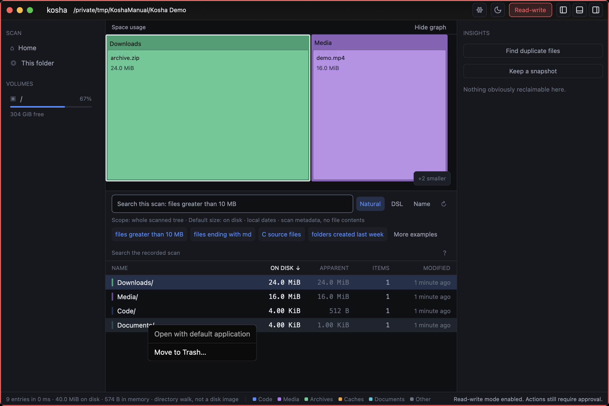
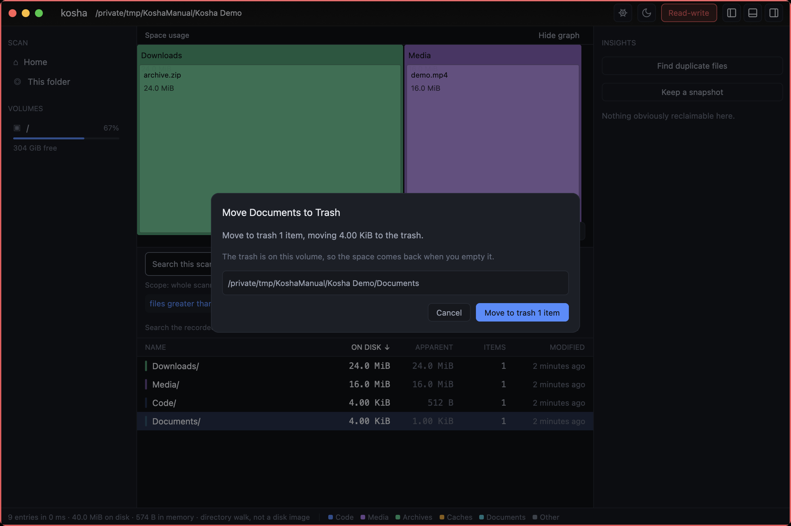

# Cleaning up safely

For data access, local records and optional network services, see the
[privacy policy](../../PRIVACY.md).

## Modes and permissions

kosha starts in **Read-only** mode. Scanning, searching, and reviewing findings
do not modify scanned files. The app can still save its own settings, snapshots,
and automatic drive history.

Use the mode control or **Ctrl+Shift+M** to request Read-write mode. Read the
confirmation before enabling it. Administrator privileges improve access; they
do not automatically enable Read-write mode.

## Review the plan

An actionable finding offers an appropriate operation. Review the named paths,
estimated effect, and plan before confirming. The app checks file identity again
before changing files and refuses protected system locations, filesystem roots,
and the home directory itself. Operations can fail when files move, permissions
change, or other processes keep files open.

You can also right-click an entry in the file list or search results and choose
**Move to Trash…**. Enable Read-write first; a live scan is required. With the
list focused, **Ctrl+Delete** on Windows/Linux or **Command+Delete** on macOS
opens the same preview. Nothing is removed until you confirm the named plan.
Preparing a preview runs in the background; Escape cancels it. A menu from an
older scan cannot act on a replacement scan.

These entry context actions are additions after 0.10.7. The examples below use
synthetic files on macOS. The same Read-write and confirmation requirements
apply on Windows and Linux.

Trash is preferred to permanent removal where supported. Trash is not a backup:
recoverability depends on the OS and destination. Permanent actions cannot be
undone by kosha. Some findings are review-only and have no destructive action.

**Space lost to cluster slack** is one such finding. It measures allocation
rounding, not files that Kosha knows are safe to delete. **Show me** locates the
largest contributors. Use an application's own cleanup for its active caches;
consider archiving only inactive documents after checking the archive and your
backup. An archive alone does not free the originals' space, and recovery is
not guaranteed to equal the displayed overhead.

After an action, kosha rescans rather than treating the old measurements as
current. There is no continuous filesystem watcher. Ordinary browsing stays at
the state observed during its scan until you rescan.

## Historical and incomplete views

A saved drive scan or explicit snapshot describes the past. File-changing
actions require a fresh scan. An incomplete scan covers only the part reached;
partial results may also include access errors. Review these indicators before
relying on totals or findings.

## Audit history

File-changing operations are recorded in `audit.jsonl` in the application-data
directory. The palette can show the log's location. It is an operation record,
not a backup or undo mechanism, and can contain affected paths and filesystem
metadata. See [settings and stored files](settings-and-files.md).
