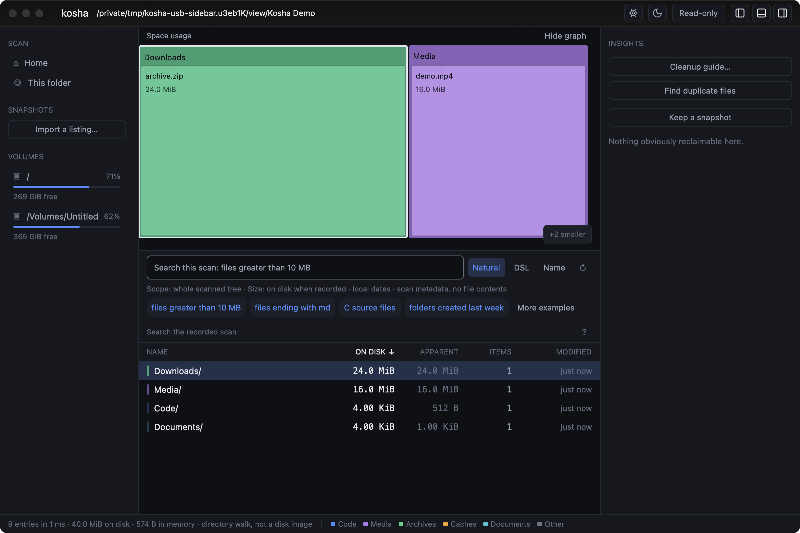

# Scanning drives, folders, and images

## Choose a scope

The sidebar offers personal folders, pinned folders, volumes, and, where
available on Windows, WSL distributions. A drive or WSL distribution click opens
its last saved scan if one exists. Kosha saves completed whole-distribution scans
on Windows so you can reopen them while the distribution is stopped. Use
**Scan again** or **Ctrl+R** to refresh the record. **Choose a folder** starts
a fresh scan of any accessible folder.

On macOS, mounted volumes under `/Volumes` appear in the sidebar, including
external USB drives. Switch back to the Kosha window after connecting a drive
to refresh the list. macOS may ask for permission when you start a scan.



By default, directory walks do not descend into other mounted filesystems.
Scan settings can change this. Symbolic links are measured without following
their targets. A scan describes its chosen scope, not necessarily an entire disk.

## Native WSL2 scans

On Windows, open **Settings** and enable **Scan inside WSL2** under **Scanning**.
Refresh the selected distribution with **Scan again**. The CLI equivalent is:

```powershell
kosha '\\wsl.localhost\Ubuntu' --wsl-native --stats
```

Install the matching Linux Kosha CLI from the
[release downloads](https://github.com/coolnew/kosha/releases) in that WSL2
distribution, using the Linux archive for its architecture. Put `kosha` on the
distribution's executable PATH, for example in `/usr/local/bin`. From
PowerShell, verify it with `wsl.exe --distribution Ubuntu --exec kosha --version`.

This starts the chosen distribution and runs as its default Linux user. The
scan stays on the Linux root filesystem and skips the root's `/mnt` branch. A
`/home` directory on the root filesystem is scanned normally, subject to the
Linux user's permissions. A separately mounted `/home` is shown as a filesystem
boundary. Check `findmnt -T /home` inside the distribution to see where it lives.
An unreadable entry or a filesystem boundary can have no measured contents.

Native results are metadata for read-only browsing. A matching CLI is required
for this mode. If it is unavailable, turn off the setting or omit
`--wsl-native` to use the Windows redirector again. In the desktop app a disk
image request, including Shift-click, takes precedence over native mode.

## Cloud-synced folders

Google Drive for desktop, iCloud Drive, OneDrive and Dropbox keep a local folder
that mirrors an online account. Kosha scans that local folder like any other. It
does not sign in to any account, contact the provider itself, or see files that
exist only online and have no local entry. The provider's own software may fetch
folder listings from its service while a folder is read; that is its behavior,
not a request made by kosha.

Some providers leave a **placeholder** for a file whose data is not stored on
this computer. A placeholder reports the file's full length but occupies almost
no disk space. Kosha recognizes placeholders only from a marker the operating
system sets on the entry, never from a folder or file name:

| System | Marker kosha reads | Status |
| --- | --- | --- |
| Windows | The offline and recall-on-open or recall-on-data-access file attributes, as used by OneDrive Files On-Demand | Tested with the offline attribute; not tested against a live cloud provider |
| macOS | The `SF_DATALESS` flag that macOS File Provider folders (under `~/Library/CloudStorage`, and iCloud Drive) use for files whose data is not downloaded | Flag logic is unit tested on synthetic data; not yet checked against a real placeholder |
| Linux | None. No standard marker exists, so a file is not identified as a placeholder | Provider mounts made by third-party tools are treated as ordinary files |

A flagged placeholder is shown with its full length as the **Apparent** size and
is marked as stored in the cloud in Quick look. Its length is an upper bound
rather than a measurement, because most of it is not on this disk. In exports the
entry carries the `offline` flag. Kosha does not open a placeholder, so scanning
does not download it. Duplicate searches skip placeholders before comparing
sizes and report how many files were skipped, because reading a file would
download it. The same applies to fragmentation checks.

Deleting a placeholder can delete the only copy, because the local entry is the
handle for the online file. From Kosha 0.12.2, a Trash or permanent-delete plan
that includes flagged files shows a warning that names how many, says that
moving them to the Trash usually deletes the online copies too, and requires a
button that names the count; **Skip cloud-only items** is offered as an
alternative. See [cloud placeholders](safety.md#cloud-placeholders). Versions
before 0.12.2 do not warn.

Fully downloaded files in synced folders carry no marker and look like ordinary
local files to Kosha, so they get **no warning**, and sync apps normally treat a
local delete as a delete. On Windows, tape or archive (hierarchical storage)
files use the same marker and are also described as stored in the cloud. Use the
provider's own software to free space, for example by choosing to keep files
online only, and check its recycle bin and retention. Keep Kosha in Read-only
mode when you scan synced folders that you do not intend to clean.

Two limits to keep in mind:

- Mirrored files (a full local copy) are ordinary files with real sizes. Which
  mode a provider is in changes how much a scan can tell you.
- How **Google Drive for desktop** presents its files is assumed from Google's and
  Apple's published descriptions and has not been verified with kosha. In its
  streaming mode on Windows it is unknown whether uncached files carry the
  Windows attributes above; if they do not, kosha treats them as local, so do not
  run a duplicate search on a streamed Drive folder. On macOS it is assumed to use
  the File Provider mechanism described above. Google Docs, Sheets and Slides
  appear locally as small pointer files, so their online storage use is not
  visible. Treat Drive results as unverified until this page says otherwise.

For mounted cloud filesystems and for files on other machines, see
[cloud storage and other machines](cloud-and-other-machines.md).

## Speed and remaining time

The scan view shows entries found and queued directories. An entry can be a file
or a directory. Speed uses a sliding window of up to 30 seconds, including time
spent waiting for filesystem reads.

When a previous finished scan of the same scope is available, kosha estimates
remaining time from its entry count and the current entries per second. The
view identifies that reference count. The estimate starts after enough
measurements are available and changes as scanning proceeds.

The total is historical: files may have been added or removed. If the new count
exceeds it, or progress stalls, kosha stops showing a countdown. A first scan
with no prior total shows throughput and **total entries unknown**. Some index
and disk-image strategies report different work units, so they show progress
without using a tree-entry countdown.

## Stop and completeness indicators

Use **Stop scan** or **Escape**. If a modal panel is open, Escape dismisses it
first. **Stopping scan…** acknowledges the request while current filesystem reads
return. Network storage or a device waiting on hardware can delay that return.

When usable results remain, the view shows **Incomplete scan** persistently.
Stopping does not replace the previous automatic drive snapshot. Some scan
strategies cannot return a usable tree after cancellation and return to idle.

| Indicator | Meaning |
| --- | --- |
| Incomplete scan | The scan was stopped, or a depth limit left folders unscanned. |
| Partial / unreadable | Some entries could not be accessed during the scan. |

Both conditions can occur together. Totals are lower bounds whenever coverage
is incomplete or entries were unreadable. A finished scan with access errors
can still be saved and keeps its unreadable indicators.

## Faster strategies and images

On Linux, a normal scan uses a parallel directory walk. Shift-click a volume
to bypass its saved observation and scan it again. The scan still respects
your account's filesystem permissions and the configured mount boundaries.

On Windows, **Shift-click** a location to request the filesystem's index for that
scan and bypass its saved view. NTFS Master File Table reading needs administrator
privileges. Reading a WSL distribution's image is another strategy. Settings can
request these strategies for future scans. Unavailable strategies fall back
where possible, with the reason reported. Administrator and Read-write are
separate choices.

Use **Scan a disk image** for a filesystem image. Readers include ext2/3/4, NTFS,
XFS, FAT12/16/32, exFAT, ISO 9660, and UDF, with supported VHDX and partition
layouts. Images are read without mounting or modifying them. A live VM's image
reflects what was written to the image, which can differ from the VM's current
view. A multi-filesystem image reports which filesystem was selected.

Next: [Results and search](results-and-search.md).
