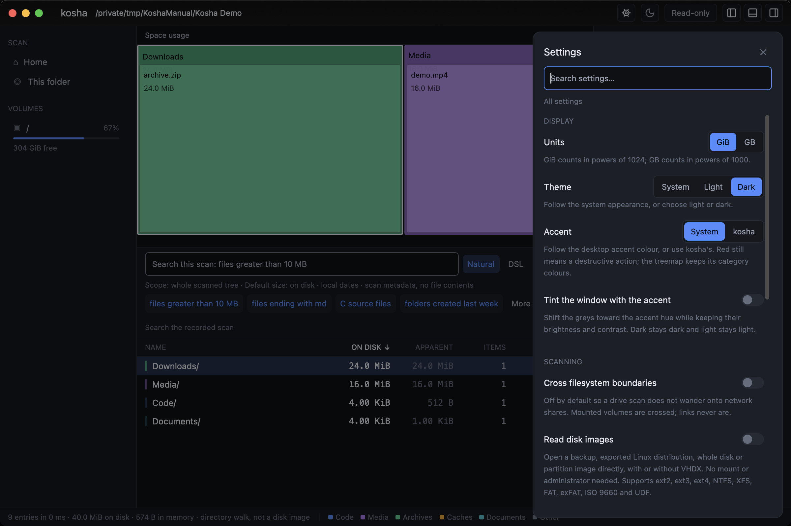

# Settings, stored files, and privacy

The [privacy policy](../../PRIVACY.md) explains local filesystem information,
optional marketplace requests, website services, and support information.

## Preferences

Open the gear control or find **Settings** in the palette. Preferences include
units, theme, accent, panels, saved searches, pinned folders, columns, and scan
and analysis options. Scan-option changes apply on the next scan; rescan to
update results already on screen.

Theme and accent are independent. **Theme → System** follows the desktop's
light/dark appearance; **Accent → System** uses its accent where supported,
falling back to Kosha's blue when no desktop accent is available. You can
switch either preference back to System without resetting the other.



| Group | What to look for |
| --- | --- |
| Display | Units, light/dark/system appearance, accent and window tint |
| Scanning | Mount boundaries, image reading, ownership collection, and platform-specific allocation, hardlink, or NTFS options |
| Advanced | Analysis thresholds in the JSON settings file and the version to include in bug reports |

To pin the current folder, open the command palette and choose **Pin … to the
sidebar**. Select the pinned location in the sidebar to scan it. Use the
palette's **Unpin** action or manage pins in Settings.

The fixed **Search settings** field filters option names, explanations, and
keywords, plus saved searches and pinned paths. Multiple words narrow the
results together: try `scan owners`, `dark`, `sparse`, or `thresholds`. The count
and clear button stay visible while the options scroll. Filtering never changes
a preference. The panel remembers its search until you clear it or close the app.
Drag the scrollbar to reach options below the fold in a short window.

The settings panel names the settings file. Advanced users can edit its JSON
while kosha is closed. Back it up first. Invalid settings are reported instead
of silently being overwritten with defaults.

## Application directories

The `kosha` CLI and `kosha-gui` resolve the same per-user configuration and
data directories when run in the same user and installation/package context.
A snapshot saved by either executable
appears in the other's snapshot list. Both read `search-recipes.json`; the CLI
can also opt into the GUI's saved drive records with `--cache`.

| Platform | Configuration | Data |
| --- | --- | --- |
| Windows | `%APPDATA%\coolnew\kosha` | `%LOCALAPPDATA%\coolnew\kosha` |
| Linux | `$XDG_CONFIG_HOME/kosha`, or `~/.config/kosha` | `$XDG_DATA_HOME/kosha`, or `~/.local/share/kosha` |
| macOS | `~/Library/Application Support/app.coolnew.kosha` | Same directory |

Linux uses the fallback when its XDG variable is unset, empty, or relative,
following the [XDG Base Directory Specification](https://specifications.freedesktop.org/basedir/).
Automatic drive records live in the data directory because they retain the
last completed observation across sessions. Windows scan
data stays in the local profile rather than roaming with settings. macOS
interactive coverage is less extensive than Windows and Linux.

The Windows paths above describe the portable ZIP installation. Development
MSIX packages can retain those logical paths while Windows redirects new data
to per-package storage. An experimental unvirtualized package can instead use
the ordinary AppData folders directly. Do not assume a packaged installation
and the ZIP share every record, or that records survive package reset/uninstall.
Back up explicit snapshots and export important results outside package-managed
storage before changing installations. Development MSIX builds are test artifacts;
there is no production MSIX distribution yet.

| File or folder | Directory | Purpose |
| --- | --- | --- |
| `settings.json` | Configuration | GUI preferences, saved queries, pins, columns, window placement |
| `search-recipes.json` | Configuration | Optional shared phrase-to-DSL [search recipes](search-recipes.md) |
| `recipe-packs/` | Configuration | Managed copies of explicitly installed recipe packs, shared by the CLI and GUI |
| `marketplace-catalog.snapshot` | Data | Last synced public marketplace catalog and its GitHub commit, shared by the CLI and GUI |
| `rules.d/` | Configuration | Optional JSON rule packs for findings |
| `insight-packs/` | Configuration | Managed review-only insight packs in builds after 0.10.7; separate from personal rules |
| `snapshots/` | Data | Explicit `.kosha` records saved by either executable |
| `drive-cache/` | Data | Automatic historical records written by the GUI and read explicitly by the CLI |
| `audit.jsonl` | Data | Append-only history of file-changing actions from the GUI |

Publisher-qualified packs use `recipe-packs/PUBLISHER/pack-ID.json`. Older flat
`recipe-packs/pack-ID.json` copies remain valid. Personal recipe files are not
merged with downloaded packs. The saved catalog is a validated snapshot of
the complete root/index set; a failed sync preserves its previous contents.
See [marketplace formats](marketplace.md) for identity and capability rules.

Exports go to the location you select, or the CLI's `--out` path. Automatic
drive-snapshot filenames are internal identifiers; the app displays their root
and age instead.

## Back up, reset, or remove records

Close kosha before managing its files. Back up `settings.json`,
`search-recipes.json`, `rules.d/`, and `snapshots/` to retain preferences,
recipes, rule packs, and explicit history. Copy exports you want to preserve.
Snapshots can be large on large trees.

Removing `drive-cache/` discards remembered drive scans; the next drive click
scans again. Removing an explicit snapshot discards that observation. Renaming
`settings.json` out of the configuration directory lets the app use defaults
while preserving the original for recovery. Removing the audit log discards
history and does not undo operations.

## Privacy and rules

Scanning, analysis, and record storage run locally. kosha has no telemetry or
cloud-sync feature. Your OS backup or sync software may still copy these files.

Snapshots and exports contain names, paths, sizes, timestamps, and any collected
ownership data. Audit entries can contain affected paths. These records do not
contain copies of scanned file contents, but their metadata can be sensitive.
Review them before sharing.

Optional rule packs in `rules.d/` extend findings and are validated before use.
Their suggestions still follow normal confidence, mode, and confirmation rules.
Rescan after editing a pack to refresh findings.

### Author local insight rules

These JSON files produce findings; [search recipes](recipe-authoring.md) instead
translate queries. [Managed insight packs](insight-packs.md) use a distinct,
review-only capability. Local insight files use this separate version-1 contract:

```json
{
  "version": 1,
  "rules": [{
    "id": "review-session-records",
    "title": "Session records to review",
    "detail": "These may contain valuable conversation history. Review before changing anything.",
    "subject": "directory",
    "location": {"base": "home", "path": ".codex/sessions"},
    "action": "review-only"
  }]
}
```

Save as a regular `.json` file directly in `rules.d/`. Use your actual tool's
storage location; this example does not discover custom profiles or classify
session histories as junk. Kosha evaluates recorded directory metadata, never
conversation contents. No commands, scripts, network access, regex, fuzzy
selectors or AI models are part of this format.

Each rule needs `id`, `title`, `detail`, `subject`, `action`, and exactly one
matcher: `location` is a structured exact path; `directory` is an exact directory
name anywhere in the scan. A directory matcher can require any of up to eight
sibling marker names in `beside`. See [location bases and limits](insight-packs.md)
for `home`, `scan_root`, `absolute`, `cache`, `temp` and `local_app_data`.
Matching is literal against recorded metadata. Unknown providers and targets
outside the recorded scan produce no match. Nodes below the minimum finding
size are omitted. The old `under-home` key is rejected; no compatibility aliases
are retained.

Location rules always require `review-only`, with likely confidence. Directory
rules support `review-only`, `trash`, or `empty-contents`; a bare name supports
only review, while a required sibling marker earns stronger evidence.
Confidence is derived, never author-supplied.
Path/name evidence does not prove data is disposable. Prefer review for history,
credentials, profiles, user-created data and tool-managed caches. In particular,
use uv's own cache commands rather than deleting its cache directly; see
[uv cache safety](https://docs.astral.sh/uv/concepts/cache/#cache-safety).
Kosha never runs the commands in explanatory text.

Builds after 0.10.7 enforce these limits: 256 KiB per file, 32 rules per file,
32 JSON files and 64 accepted rules across the directory. Fields are bounded
in UTF-8 bytes: ID 80, title 160, detail 4,096, subject 80, directory name 255,
relative home path 1,024, and each sibling marker 255. IDs use lowercase ASCII
letters, digits and hyphens and cannot duplicate built-ins or earlier files.
Files load in filename order. Over-budget or malformed files and unknown JSON
fields are refused; a bad individual rule leaves valid rules in that file usable.
A file that exceeds the remaining aggregate rule budget is skipped as a whole;
more than 32 JSON files refuses the directory. Errors are reported and inputs
are never rewritten. Links and directories are not rule files.

These budgets bound loading and rule count; they are not a scan-time guarantee.
Directory-name rules can still examine a large tree; exact home-path rules use
the existing sorted child-name index. Managed insights have stricter path and
aggregate limits and do not accept directory-name or destructive rules.
A finding never grants filesystem access or bypasses the normal mode,
preview, source, identity and confirmation safeguards.
