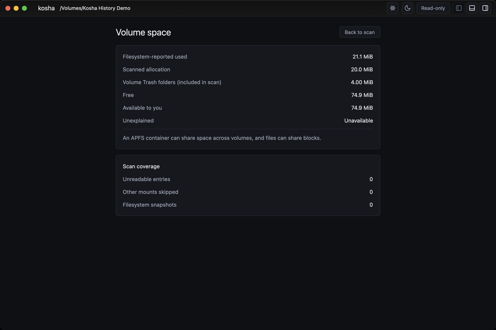
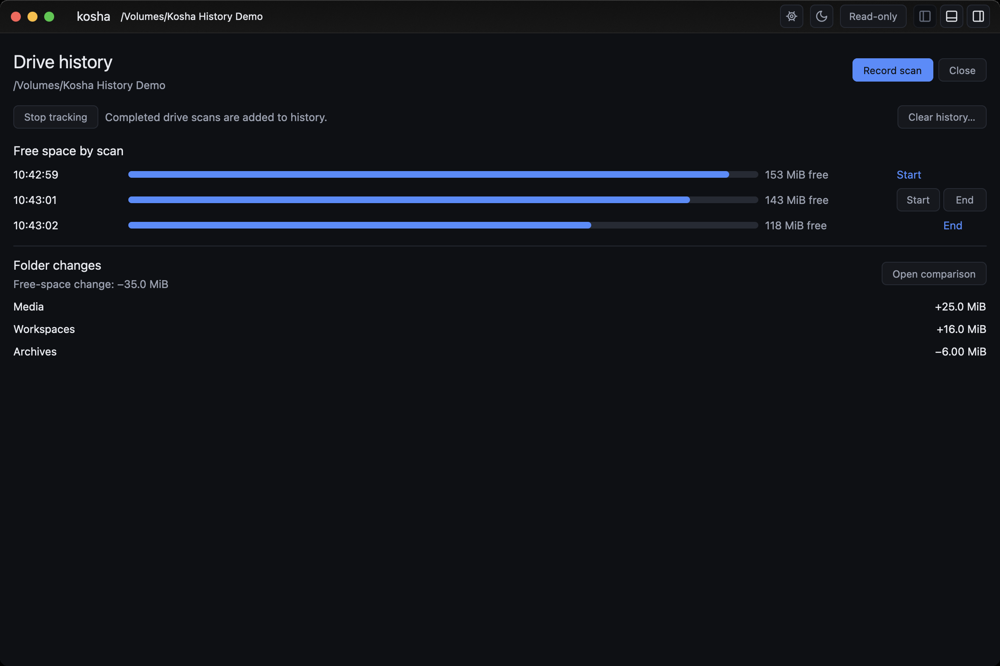
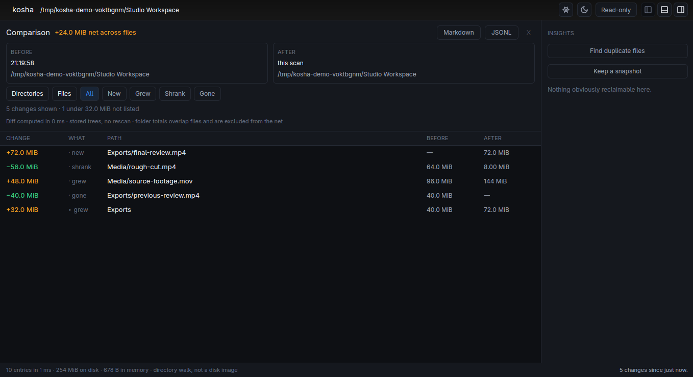
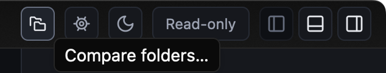
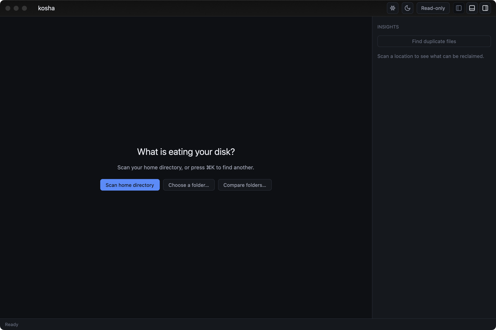
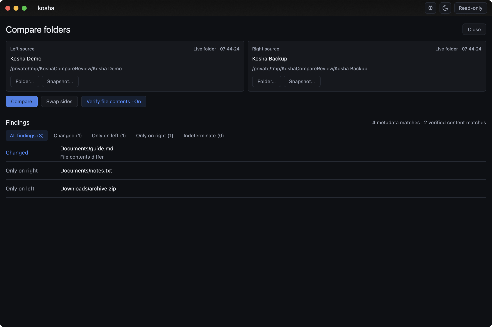

# Saved drive scans, snapshots, and comparisons

Both kinds of record store sizes and metadata, not copies of file contents.

New snapshots use format 2 and retain filesystem creation dates where the scan
recorded them. Format 1 records still open, with creation dates marked unknown.
Keeping an older automatic record preserves its original metadata; it does not
invent missing dates. Older kosha builds cannot open format 2 records.
From Kosha 0.13.0, imported listings use format 3, so an older Kosha refuses
them instead of showing them as its own scans.

| Record | Created by | In snapshot list | Retention |
| --- | --- | --- | --- |
| Automatic drive scan | Finished drive-root scan in the desktop app | No | One replaceable slot per drive root |
| Explicit snapshot | **Keep a snapshot**, or CLI `--snapshot` | Yes | Kept until removed |
| Imported listing (from 0.13.0) | CLI `kosha import` | Yes | Kept until removed |

The CLI lists these separately: `kosha --snapshots` shows explicit snapshots;
`kosha --caches` shows automatic drive records and their age without rescanning.
Cache listings read headers only. See the [command-line guide](command-line.md#explicitly-use-the-gui-cache)
for JSON/JSONL inventory and error statuses.

## Automatic drive scans

A finished drive scan is written in the background. Selecting that drive again
can display the finished record immediately in the same session. After an app
restart, selecting the drive reads the record from disk and shows **Opening
saved scan** while it loads. Press Esc to dismiss the load.

**Saved scan** beside the breadcrumb shows its age. **Scan again** or **Ctrl+R**
refreshes the disk view. Shift-clicking the drive requests a new scan using an
available filesystem-index strategy. Missing or unreadable saved records trigger
a scan.

A new finished scan replaces the automatic record. Cancelled and depth-limited
scans do not. Finished scans with inaccessible entries can be kept and retain
their partial indicators. Folder scans are not saved automatically.

History follows the drive's root path. A replacement removable drive or changed
drive-letter assignment can therefore open a record of the previous disk. Check
the age and choose **Scan again** before relying on it.

## Review volume space

After a fresh scan of a supported local drive, choose **Volume space** from
the toolbar. Compare the filesystem’s reported usage and free space with
the allocation visible in the scan. **Available to you** accounts for
restrictions such as quotas or reserved blocks. On Windows the used figure
follows the caller’s quota scope.

[View Volume space on Windows, with caller-scoped usage and estimated scanned allocation.](images/gui-windows-volume-space.png)

[View Volume space on Linux, with reserved free space and a 33 KiB unexplained difference on a synthetic ext4 volume.](images/gui-linux-volume-space.png)

The scan labels partial and estimated totals and reports unreadable entries
and skipped mounts. If the scan could read a recognized volume Trash folder,
its allocation is shown as part of the scanned total. Trash stored elsewhere
and snapshots can affect usage without appearing in that row. On macOS,
Kosha can show the filesystem snapshot count when the volume exposes it.
Snapshot space remains unquantified.

Kosha reports an unexplained difference only when the filesystem accounting
scope is supported, the counters agree before and after the scan, and scan coverage supports
the comparison. The difference can include filesystem overhead and allocation
outside the scan. Shared APFS accounting and Windows quotas can prevent a
reliable difference.

Run `kosha space ROOT` for a fresh read-only volume scan, or add
`--format jsonl` for a structured summary. A null gap has a status explaining
why a size could not be reported.

## Review drive history

Open a local drive in the desktop app and choose **History** beside its
breadcrumb. **Record scan** takes a new drive scan and adds an observation.
After the second observation, Kosha shows free space for each scan and ranks
the largest top-level folder changes by allocated size.

Choose **Track this drive** to add future completed drive scans to its history
automatically. Tracking is off by default and does not schedule additional
scans. **Stop tracking** keeps the existing observations. **Clear history…**
asks for confirmation before removing observations for the selected drive.
If tracking is on, future completed scans start a new history.

The newest two observations are selected initially. Change the interval with
**Start** and **End** beside the observations. **Open comparison** opens the
two saved records to show individual path changes and export the findings.
Kosha marks partial scans and displays folder growth only for compatible,
complete observations.

[View Drive History on Windows with a 6 MiB change to a synthetic NTFS volume.](images/gui-windows-drive-history.png)

### Record drive history from the command line

Use a mounted local volume root, such as an external drive. Run
`kosha history record ROOT` to take a scan and save its capacity and free-space
measurements alongside the snapshot. Repeat after the drive changes.
`kosha history list ROOT` lists the observations in time order. Use
`--format jsonl` for timestamps in Unix milliseconds, byte totals and snapshot
paths. Run `kosha history growth ROOT` to rank measured allocation changes
in top-level folders between the newest two complete, compatible scans.
That ranking can account for some of the volume's free-space change. Pass two
listed snapshot paths to `kosha compare` to see individual changes.

History is separate from saved drive scans and explicit snapshots. It follows a
supported volume identifier across changes to the mount path. On Linux, this
requires a whole local block filesystem with a matching UUID in
`/dev/disk/by-uuid`. Network volumes, WSL paths viewed through Windows, and
volumes without a supported identifier are unavailable. Partial scans are
marked. A missing free-space measurement is reported as unavailable.

Kosha keeps up to eight observations and 512 MiB of history per volume. It keeps
the newest observation even if that snapshot alone exceeds the byte limit.

## Explicit snapshots

After a fresh scan, choose **Keep a snapshot**. It appears in the sidebar with
its root, age, and storage size. Explicit snapshots do not overwrite one another.
You can also open a `.kosha` snapshot directly.

In the CLI, use its full/relative path or exact stored filename, including
`.kosha`. Existing local files take precedence over a stored copy with the same
name. `./NAME.kosha` requires that local path; the full store path printed by
`--snapshots` selects the stored copy explicitly. The same rules apply to
`--since` and search `--load`. Corrupt local files fail without substituting a
different saved record; labels and partial filenames are not shortcuts.

While viewing an automatic **Saved scan**, choose **Keep saved scan as snapshot**
to keep that historical observation without rescanning. The note under the
button shows the original date; the command palette offers the same action.
The explicit snapshot keeps that date, including its original timestamp precision,
and the scan's measurement metadata. The confirmation notice repeats that the
original scan date was preserved.

The snapshot file's filesystem creation time reflects when you kept it; kosha's
displayed scan date remains the original observation date.

The kept copy appears in the snapshot list and survives future replacement of
the automatic drive record. Keeping a cached scan does not make it current:
its age and historical-view safeguards still apply. When you open an explicitly
kept snapshot, it is already in the list and does not offer another keep action.

A newly saved stopped scan retains **Incomplete scan** when reopened. Older
snapshot formats may lack that specific cancellation detail. Prefer a finished
scan when making a baseline with full traversal coverage.

## Snapshots from another system

A `.kosha` file can be opened on a different operating system from the one
that recorded it. Names are kept exactly as recorded wherever the opening
system can represent them. Linux allows file names that are not valid UTF-8
text, and Windows cannot represent some of them. When such a snapshot is opened
on Windows, those names are shown with the replacement character � and the
app's notice (or a `note:` line on the CLI's standard error) says how many names
were affected. Sizes and the folder structure are unchanged. A comparison may
report those entries as gone and new, and a [metadata view](metadata-views.md)
refuses to share a replaced name.

To bring a snapshot from another machine, see
[cloud storage and other machines](cloud-and-other-machines.md#other-machines).

## Imported listings

From Kosha 0.13.0, `kosha import --from ncdu FILE` keeps an
[ncdu](https://dev.yorhel.nl/ncdu) JSON export as a record; see the
[command-line guide](command-line.md#import-an-ncdu-listing) for the command.
ncdu can run on a machine where Kosha is not installed, and its export can be
copied or piped here. Kosha reads only the file you name (or standard input),
starts no program and makes no network request.

From Kosha 0.14.0, you can also [import an rclone listing](command-line.md#import-an-rclone-listing).
Choose **Import a listing** under **Snapshots** in the desktop app to preview,
name and save an ncdu or rclone listing in a dialog. Press Escape to cancel
reading or close the preview. rclone provides apparent sizes only.
A listing can retain duplicate paths, which makes path comparison unavailable
for that record.

An imported record is not a Kosha scan, and every view says so: the CLI header,
`--stats`, the `--snapshots` list and search print
`Imported from ncdu 2.9 (export 2026-11-20 14:02 UTC). Not measured by Kosha.`
with the tool and date from the file. In the desktop app the chip beside the
breadcrumb reads **Imported · ncdu** and the status bar repeats the sentence.
If the export has no timestamp, the line says `observed: unknown` and gives the
import date.

What is recorded, from the export:

- Names, the folder structure, apparent size (`asize`) and ncdu's disk usage
  (`dsize`). If the export records no disk usage at all, on-disk sizes are
  stored equal to apparent sizes and every view says they were not recorded.
- Modification times, only when ncdu exported them (`ncdu -e`). Otherwise date
  conditions in searches match nothing in the record.
- Hard links: entries with the same device and inode count once, as ncdu does.
- Entries ncdu could not read, excluded or did not cross into are kept and
  flagged; totals are then shown as lower bounds.
- Creation dates and owners are not recorded.

An imported record allows no file action of any kind, in any mode: no deletion,
Trash, open, reveal, duplicate search or rescan. Its root is a label for a
place on another machine, not a path on this one. Insights may still describe
build output or caches, as advice about the source machine; rules about this
machine's allocation (cluster slack, sparse files, compression) do not run.
Comparisons with imported records work and warn that the sizes came from
another tool.

Limits: ncdu's binary export (`ncdu -O`) is not read; export JSON with
`ncdu -o` instead. An export with file names that are not valid UTF-8 is not
valid JSON and is refused; convert it first, for example with `iconv`. Imports
are refused above 8 GiB of input or decompressed data (raise with
`--max-input-bytes`), 50 million entries, 120 directory levels, 4096-byte
names, or a zstd window larger than 8 MiB. Names that would step outside their
folder (`.`, `..`, a `/` or NUL) are refused, naming the entry. A refused
import writes nothing.

## Compare observations

The snapshot sidebar offers **All** and **This location**. This location shows
explicit snapshots whose drive or folder root matches the open scan's root;
drilling into a subfolder does not change that root. The choice is remembered.
With no scan open, All is available so you can still open any saved snapshot.

Use the palette's comparison action to compare the current tree with a kept
snapshot. Comparisons describe recorded observations, not continuous activity.
Rescan to refresh the current side.

**What changed** compares the tree already in memory with the selected snapshot.
It does not scan again. This also works when the current view came from an
automatic drive record or another explicit snapshot. Reading the selected record
and computing the comparison run in the background; large records can still take
time. The older observation is always the Before side.

The comparison shows both roots and observation dates, separate Before and After
sizes, and a net change across files. Directory totals overlap their children and
are excluded from the net. Filter directories/files and All, New, Grew, Shrank,
or Gone. Hover for a full path; click a row to copy its relative path.

Choose **Markdown** or **JSONL** above the comparison, or the matching command
palette export action. Exports capture the visible filters when invoked and
include the roots, observation timestamps, threshold, and warnings. Markdown
separates directory and file tables. JSONL starts with a comparison metadata
record followed by one change record per visible row, with exact byte sizes and
signed deltas. The overall net includes all file changes, including changes
below the threshold; it is not the sum of filtered rows. Exporting does not rescan.

Use the same root and comparable scan settings. Differences in mount boundaries,
allocation measurement, hardlink rules, access, and completeness can look like
changes in files. Read comparison warnings.

Historical views retain snapshot safety guards: scan again before file-changing
actions. A record of yesterday's file cannot establish its current identity or
contents. See [file locations](settings-and-files.md) for backup and removal.

### Compare two folders or snapshots

Choose **Compare folders…** from the welcome screen or select the two-folders
icon in the title bar. Hover over the icon to see its label. Comparison is
also available in the command palette (Ctrl+K or Command+K). If you open it
while browsing a local scan or saved snapshot, Kosha fills in the left side
with that source. For each side, choose **Folder…** for a live scan or
**Snapshot…** to use a saved Kosha record. Choose **Compare** to run it, or
**Swap sides** to reverse the direction. You can cancel from the comparison
page or the background actions panel.

The report lists differences and indeterminate paths, with a reason for each
finding. Select a status above the list to focus on that category. The report
also counts matching metadata and warns when either source has
incomplete coverage. Under **Export findings**, choose **Plain text** (.txt)
for quick reading, **Markdown** (.md) for sharing, or **JSONL** (.jsonl) for
scripts. The saved report includes the selected findings filter, source
details, coverage warnings, and totals for the complete comparison. Exporting
uses the displayed results and does not rerun the comparison.
[View the export controls on macOS.](images/gui-macos-folder-export.png)

Relative paths are matched byte for byte. The comparison
uses entry type, apparent size, and modification time with a two-second
tolerance. On Windows, macOS, and Linux, turn on **Verify file contents** before running
the comparison to check equal-size regular files at matching paths. This reads
both files and reports verified content matches separately from metadata matches.
The option is available when both sources are live folders.

On Windows, a WSL folder opened through `\\wsl.localhost` can be compared by
metadata. If file contents show as indeterminate, the
[command-line guide](command-line.md#compare-folders-and-saved-snapshots) shows
how to run byte verification from inside the distribution.

[View a Windows comparison with one verified content match and one file unique to each side.](images/gui-windows-folder-comparison.png)
[View a Linux comparison that also finds a same-size edit.](images/gui-linux-folder-comparison.png)
