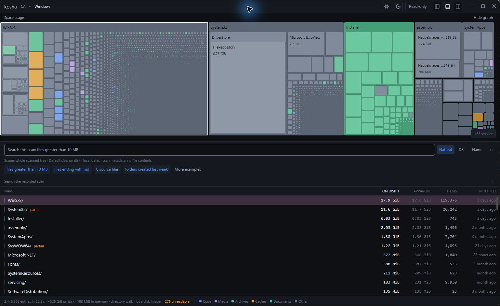
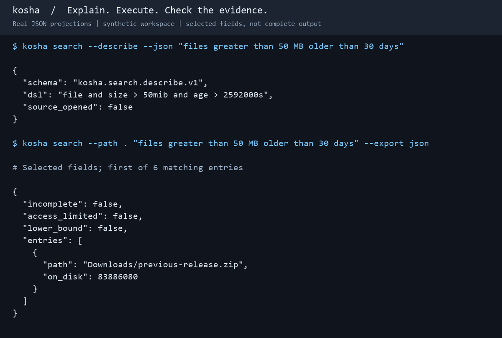

YOUR DISK, UNDERSTOOD.

# Find the space. Keep what matters.

Kosha turns a crowded drive into a clear picture. Explore a visual map of your
files, search in plain language, and compare snapshots to see what changed.
One fast disk explorer. A desktop app for you. A CLI for your tools and agents.

[Download Kosha](https://github.com/coolnew/kosha/releases){ .button .primary }
[Get started](../docs/manual/getting-started.md){ .button }

Windows · Linux · Experimental macOS · Open source · MIT / Apache 2.0
{ .platforms }

## Millions of entries. A clearer picture.

WINDOWS REFERENCE RUNS · KOSHA 0.10.3

11.4seconds

**2.86 million entries · NVMe SSD**

Crucial P3 1 TB · NTFS MFT · Administrator

20.1seconds

**4.09 million entries · HDD**

Ultrastar DC HC550 16 TB · NTFS MFT · Administrator

The complete set of supplied observations:

| Storage | Method / privilege | Entries | Scan time | Reported coverage |
| --- | --- | ---: | ---: | --- |
| NVMe SSD | Directory walk, standard user | 2,849,859 | 15.3 s | 10 unreadable; lower-bound totals |
| NVMe SSD | NTFS MFT, administrator | 2,855,411 | 11.4 s | All files accessed, as reported |
| HDD | Directory walk, standard user | 4,088,836 | 12m 32s | 22 unreadable; lower-bound totals |
| HDD | NTFS MFT, administrator | 4,089,362 | 20.1 s | All files accessed, as reported |

**Reference observations, not a controlled benchmark.** Cache state and
repetitions were not recorded, and entry counts and size totals differ.
These are filesystem metadata timings; reported disk usage is not file-content
throughput. Results describe these supplied 0.10.3 runs, not a speedup guarantee.

[Read the full observations and hardware context](../docs/manual/performance.md){ .button }

## Less digging. More understanding.

### See the whole picture

Follow the treemap from a drive to the files taking up space. Review findings
alongside the file list, with explanations that help you decide what to keep.

[Explore the desktop](../docs/manual/desktop-tour.md)

### Ask for what you need

Try “images larger than 10 MB” or “files created last week.” Inspect the query
interpretation, refine it, and export your results.

[Learn smart search](../docs/manual/results-and-search.md)

### Know what changed

Keep snapshots, compare scans, and follow growth over time. Saved drive scans
let you return to the last result with its age clearly shown.

[Work with snapshots](../docs/manual/snapshots.md)

## Your terminal. Your workflow.

Scan, search, compare, and export from the command line. Structured output and a
concise agent guide make Kosha useful in scripts and coding-agent workflows too.

[Read the CLI guide](../docs/manual/command-line.md){ .button }
[Guide for coding agents](../LLMS.md){ .button }

## Powerful search, made yours.

Create your own recipes and explore marketplace packs. Deterministic translation
keeps search local without a model or cloud service. See what a phrase means
before relying on its results.

[Use custom recipes](../docs/manual/search-recipes.md) ·
[Author a recipe pack](../docs/manual/recipe-authoring.md)

## Confidence comes from visibility.

Scanning is read-only by default. Desktop cleanup requires an explicit mode
change and review; the CLI has no delete command. Understand the boundaries,
then check the evidence: tests, measured coverage, source commit, and report age.

[Safety and privacy](../docs/manual/safety.md){ .button }
[Test quality and coverage](../docs/manual/quality-and-coverage.md){ .button }
[View coverage report](https://coolnew.github.io/kosha/coverage/){ .button }

Kosha is under active development. These guides describe the current source;
check your installed version when following them. The project was developed
with assistance from large language models; changes remain subject to maintainer
review and testing.
